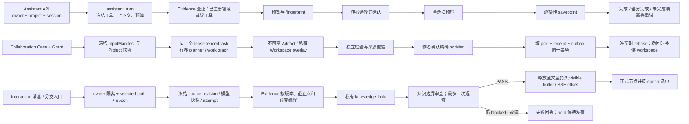

# L5：Assistant / Collaboration / Interaction 源码核对

## 范围与结论

核对基线为 `22bb499789cba89fea92e918fd853ab768688e07`。隔离 worktree 的 HEAD 与该 SHA 一致；看到的未提交改动限于主任务文档，不把这些草稿当作代码证据。本报告是 P1 静态只读核对；没有执行测试、访问数据库、调用模型或验证真实产品效果。

三条主链路都已有可追溯的模块文档，不需要新建模块说明。Assistant 的运行边界、证据引用、确认批次和失败重试，Collaboration 的授权试验、隔离工作区、事务采用与补偿恢复，以及 Interaction 的源作品隔离、选中路径、epoch、SSE 和摘要大体吻合代码。发现一处有实际意义的文档冲突：Interaction §“生成与恢复”仍说失败残段可由用户保留，但新生成内容先进入私有知识 hold；在审查通过前 `visible_text` 为空，现有 `keep_partial` 只正式化 `visible_text`，并没有把 hold 正文公开的路径。应按当前代码修正文档承诺，或另立实现/产品问题确认是否要提供“保留未审正文”的安全流程。

## 端到端路径

### Assistant

公开入口由 `backend/app/main.py` 挂载 `/api/assistant`。提交回合时服务端核验功能开关、当前项目及 owner、活动会话、operation 幂等键，并把上下文、Project LLM 执行快照、操作签名、读取工具签名及预算冻结到 `AssistantRun`，再排入 `assistant_turn`。worker handler 要求 task lease/checkpoint session；执行时重读 owner、恢复冻结的 Project snapshot，并对运行状态、task id 和工具协议做 fence。

运行工具只能使用冻结目录中的已注册能力。Evidence 引用必须来自本轮已读证据；搜索摘要不能充当已核实引用；称为“已验证问题”的 finding 必须引用领域复核 finding。查证/建议类 operation 复用原领域 task 和结果读取接口，并纳入同一 `AgentRunBudget`；对业务资料的修改只成为 action batch。批次先保存每个 action 的预览、参数与基线指纹；作者决定绑定 batch fingerprint 和 selected keys。确认时先重验全部选中操作和当前来源，再逐 action 用 nested transaction 执行。失败项阻断其依赖项，成功项保留；同一 retry id 重放不重复写入，只允许重试原确认中未完成项。

`team-runs` 不是任意团队运行时，而是同一 Assistant run 下的服务端 blueprint。提交冻结 blueprint/hash、工具签名及预算；成员有独立 history/evidence refs，但共用 host task lease、根预算和授权范围。成员调查后，部分蓝图调用领域复核，编辑员汇总覆盖与遗漏；整组最终答复仍经证据与知识边界校验。方案选择是单独的服务端选择步骤，之后才准备普通、作者确认的 action batch。静态代码证明了执行约束，不证明审稿的模型质量。

### Collaboration

`/api/collaboration` 的 case 创建冻结作者目标、授权 Grant、Recipe 和来源 InputManifest。`submit_run` 检查目标版本、幂等键、剩余额度及同 case 活动任务，固定每个角色的 Project LLM snapshot，然后排入一个 `collaboration_run`。task 声明 `collaboration.run` root capability、30 次请求、1800 秒 deadline 和 `manual_resume`。执行前后 `fence()` 重验 lease/task/generation、目标版本、Grant hash、原始 manifest 及既有 artifact manifests；未知用量直接阻止下一步。规划器生成 recipe 能力收窄后的有界工作图，独立问题和作者待决事项可形成 partial，而不是把“规划结束”伪装成完整检查。

成果先保存在 immutable artifact/workspace baseline + overlay，不直接写 Canon。检查绑定原始完整读集、作者保留项和当前精确试改。采用要求 active case、有效授权、当前 revision digest、sealed 且通过的检查、完整来源重验及明确作者确认；domain ports 先全部 validate，再在同一事务内 apply，保存 receipt 与 outbox。相同 operation/revision 只回读原 receipt。恢复保留 succeeded artifacts 和历史用量，只重置未完成 work items 并增加 generation；Grant 到期、撤销或全局开关关闭时 maintenance 取消未完成 task 并保留已有回执。Rebase 对逻辑资源做三方比较，重叠字段留给作者；revert 建立新的补偿 workspace，仍需检查和采用，不抹去原 receipt。

明确 `retain_understanding` 后，只有完整运行成功且复核通过的工作项能进入持久理解；依赖保留整个实际读集和来源版本。CAS、幂等、no-change 回执及追加式作者修正/撤回约束防止机器覆盖作者决定。理解只可按作者回顾用途经 Evidence 再物化；排除、换版、作者修正或撤回会使旧引用失效，不能把作者回顾当作角色当时已知事实。

### Interaction / RP

浏览器只提交旅程/节点/attempt 的业务 ID；服务端由当前 principal 取得 owner 与隐藏 interaction `novel_id`。每个旅程使用单独的 `project_kind=interaction` 项目。跨项目唯一窄例外是同 owner 的 author source revision → RP consumer 的只读引用：来源 owner、来源 author 项目、ready revision 和固定 fingerprint/manifest 必须通过 source facade 重验；Evidence 读取使用 source `novel_id`，attempt/节点写入 consumer `novel_id`。公开 demo 只允许配置中固定的 ready revision。

用户消息和分支切换要求 `expected_selection_epoch`，写入不可变 sibling，并更新选中路径。attempt 固定 selected path hash、source revision、started source epoch、selection epoch 与 Project LLM snapshot。生成准备只重建并验证选中祖先；来源 revision/epoch、选中路径或 owner 变化会在 checkpoint/finalize 被重新核验，晚到结果即使保留也不能抢选中路径。Evidence 按 frozen source manifest、章节/同章 offset、人物知识、固定/排除策略及引用预算编译；必需资料失效或放不下时 fail-closed，不退回纯模型知识。

登录态 SSE 以 owner + journey + attempt 查询数据库中的 `visible_text` / `visible_offset`，按 offset 回放；offset 超过持久值时 reset 后重放，不依赖进程内 buffer。普通 stream 每约 2 秒或 512 字符 checkpoint，但在 held 语义下这段新文本写入 attempt 私有 checkpoint 的 `knowledge_hold`，不增加 SSE 可见 offset。审查 PASS 后将完整正文写入 visible buffer；blocked 且最多一次返修后仍未通过，attempt 失败，正文留在 private hold。摘要刷新任务是独立 auto-requeue 任务，最多两次 task attempt、八次 root request，无整条任务总 deadline；自动 segment/overview 和手工 overview 都保留不可变 lineage，并按当前分支、coverage 与手工 authority 选择恢复输入。

## 失败、恢复、撤权与默认值

- Assistant 的普通失败只可在 task lifecycle 仍允许恢复且原预算未过期时恢复同一 run。`renew_budget` 是明确的新回合，保留原讨论/上下文来源；批次部分成功使用原授权后置状态，只重新查证和重试未完成项，不回滚已完成操作。`sources` 投影和批次确认都重验范围与原 confirmation。
- Collaboration 的 `resume_run` 要求 case/Grant 仍 active、用量已知、剩余时间与根额度足够、source manifest 未变化、没有活动兄弟任务。恢复沿用同一 run/累计消费并保留成功 artifacts；不可恢复时明确要求新建一轮。授权撤销、到期或 recipe/功能不可用会停止未完成 run；已采用 domain writes 和 receipt 不会自动回滚。
- Interaction 的普通 provider transport retries 关闭；错误会把残文存入 attempt，task owner reconciler 会将 task 已终止但 attempt 仍 active 的记录收敛为 failed，且不把晚到文字静默晋升到选中历史。`length` 只允许一次手工或看海续段，后续再截断形成 partial node。显式离开故事页撤销看海后继授权，但不取消正在进行的当前 step；路径/资料 epoch 漂移则使旧输出失效。
- 相关功能配置默认关闭：`ASSISTANT_ENABLED`、`COLLABORATION_V2_ENABLED`、各 Assistant team blueprint 开关、`INTERACTION_AGENT_ENABLED`、`INTERACTION_TEAM_ENABLED`、`INTERACTION_FORECAST_ENABLED` 均为 false。实际启用状态仍须读取运行配置，静态默认值不能代表部署值。

## 文档保留和最小修订建议

- 保留 `docs/modules/20_assistant.md` 的“所有权”“运行原则”“成组执行与恢复”“有限协作”“审稿方法版本与离线对照”，以及前瞻、主动提醒和专项能力章节。它准确区分领域事实所有权、读写确认、预算和真实质量验收。对应模块 README 是内部运行时/表职责导航，不替代产品边界文档。
- 保留 `docs/modules/21_collaboration.md` 的“数据与执行”“采用与恢复”“资料、配方与共用试验”“自动跟进与恢复”“持久理解的保留与复用”“条件比较授权”。其中采用章节正确表达写入前检查、domain port、事务 receipt 与需要重新检查的补偿恢复；不要把一次 partial run 误写成“部分写入”，也不要把工程测试描述为真实模型验收。
- 保留 `docs/modules/18_interaction.md` 的“定位”“核心模型”“回顾与上下文”“有界单 Agent”“多角色演绎”及其 source/epoch 和输出治理段落。对照 §“生成与恢复”第 50–61 行与 §“有界单 Agent”第 175–177 行：后者准确说明审查前 SSE 不发 chunk、PASS 后整体释放、blocked 后正文留在 hold；原第 55–56 行“技术失败残段……用户可保留”不能直接套用到 held 新运行。应区分失败与停止：审查/生成失败的 hold 私有保留；stop 会取消 attempt 并清理私有运行状态；两者都不能经 `keep_partial` 发布未释放正文，且不应承诺 stop 后可恢复 hold。已进入 `visible_text` 的历史/兼容片段仍可沿用可见片段路径。若产品希望用户能保留未审文本，需要单独定义其安全审查/释放语义，不应由文档默认承诺。
- 三个 `backend/modules/*/README.md` 保持为靠近代码的协议索引：Assistant 首部运行信封与成组执行、Collaboration 的预算/租约/事务采用/理解保留、Interaction 的 attempt 信封/恢复/hold。三者已有文档组合覆盖范围；没有创建新文档的理由。跨模块流程图可放在既有总架构文档或计划中，避免再建一份重复事实源。

本次只定位测试符号并核对源码，未执行测试。尤其缺少一个明确串联“知识 hold 中用户主动 stop/失败后 keep partial”的测试；现有 `test_hold_writes_stay_private` 证明 `visible_text` 不包含 hold，`test_stop_attempt_formalizes_visible_text_once_as_partial` 的 fixture 直接预置了可见正文，因此不能证明 held 正文可被保留。真实模型质量、盲评、浏览器、生产和用户验收均未验证。

## P3 交互模块文档修订

在指定 writer worktree（HEAD `22bb499789cba89fea92e918fd853ab768688e07`）仅修改 `docs/modules/18_interaction.md` 的“生成与恢复”段落及其同页交叉指向。原先“技术失败残段仍留在 attempt，用户可保留或重试”未区分新 held 运行与旧/兼容可见缓冲，容易让人以为未审正文可被 `keep_partial` 发布。

修订后的准确行为是：`stop_attempt` 与 `keep_partial` 只把已写入 `visible_text` 的正文正式化为 partial，已可见的历史/兼容残段仍沿用此路径；新运行在知识边界审查前把正文留在私有 `knowledge_hold`，审查 PASS 后才将全文写入 `visible_text`。审查/生成失败会把 hold 留在私有 attempt 记录；主动停止会取消 attempt 并调用私有状态清理，但不能将未释放正文转为 visible/partial，文档也不承诺停止后可恢复 hold。§“有界单 Agent”补充指向§“生成与恢复”，避免重复描述恢复边界。

源码依据：`backend/modules/interaction/generation.py::checkpoint_story_task`（约 614–628 行）把 delta 写入 hold、保持 visible buffer/offset 不变；`release_story_task`（730–770 行）仅在审查后将全文写入 visible buffer；`fail_knowledge_hold`（772–815 行）失败后保留私有 hold 并将 attempt 标为 failed；provider 错误保存 held delta 后关闭 attempt（约 1288–1314 行）。`backend/modules/interaction/services.py::stop_attempt` / `keep_partial`（约 908–1024 行）调用 `_stop_locked_attempt`；该 helper（1815–1857 行）只检查 `attempt.visible_text`，无可见正文时将 attempt 取消，并调用 `clear_private_agent_state`；`_formalize_partial_attempt`（1859–1917 行）也只以 `visible_text` 建 partial。`runtime_policy.py::clear_private_agent_state`（71–95 行）在清理 agent 执行状态时保留私有 hold 字段，但停止路径没有将其恢复/发布为正文的用户操作；文档据此不承诺 stop 后的 hold 可恢复。

测试边界：`test_hold_writes_stay_private`（`backend/modules/interaction/tests/test_knowledge_hold.py`）只证明 hold delta 不进入 visible buffer；`test_stop_attempt_formalizes_visible_text_once_as_partial`（`backend/modules/interaction/tests/test_services.py`）直接预置 `visible_text`，不证明 held 正文可恢复。既有兼容可见残段路径有 `test_archive_awaiting_continue_formalizes_visible_text_as_partial` 与 `test_archive_latest_failed_visible_text_as_partial`；这些同样只验证已可见缓冲。没有执行测试或业务调用；本次仅做静态代码核验和文档修订。
