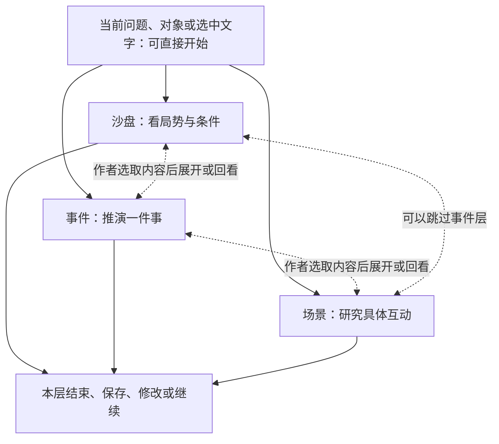

# 导演工具的多尺度独立使用：沙盘、事件与场景研究

研究日期：2026-10-17。状态：研究报告已完成，经过独立来源核验、综合、反方、编辑与归因审读。适用对象：维护世界设定、构思剧情或处理局部写作问题的小说作者。

## 摘要

建议把沙盘、事件、场景作为可以直接进入、独立产出、按需往返的三种观察尺度。当前更值得试验的产品形态是“自由描述问题＋可选尺度＋工作位置旁的快捷入口”；事件能力应能单独启动，是否建设第三套工作台仍待作者任务证据决定。研究细分21个方向，覆盖制度资源、行动与信念、对话视角、日常生活和非冲突表达。分尺度可能帮助缩小一次推演的资料和输出范围，也可能增加交接负担、摘要损失和错误级联；宏观抽象本身不保证更容易或更可信。本报告综合20项经独立核验的核心来源，并核对项目的实际调用链，区分论文观察、创作论、跨领域借鉴和原创建议。代码显示已有世界推进与场景导演可作为基础，但它们仍依赖实际Scene，现有交汇转导演也尚非完整未来状态移交。研究未运行当前业务模型或组织中文作者试用，以下优先级与预期收益均为待验证方案。

## 1. 研究问题、方法与证据边界

本次研究承接三个已明确要求：每个方向继续细分；每个尺度都能方便地单独使用；尺度之间的连接可选且支持双向。交付是应用型研究和设计建议，不改变产品规范、已采纳ADR或生产代码。

研究问题有四组：分尺度能否改善作者完成任务的效率与可用结果；独立开局需要哪些最少材料；事件是否值得独立模式；怎样控制跨层的条件丢失、知识越界与错误传播。研究先完成范围反方检查，再按宏观、事件、场景、交互、模型五分支检索，并独立调查本地实现；随后核验来源、综合并审读。

检索采用中英关键词，优先原始论文、作者原典、出版方和官方方法文档。关键词覆盖scenario planning、agent-based model validation、narrative planning、intentionality/belief、hierarchical story generation、human-AI creative writing、author control、psychological ownership、long-context use、self-correction及其中文对应词。具体检索组、读到的章节、排除与失败记录见各分支材料和[独立来源核验](artifacts/VERIFICATION.md)。这不是PRISMA系统综述，没有文献穷尽、双人全文筛选或元分析的声明。

证据分为四种用途：原始系统/用户研究用于支持其特定任务中的机制或观察；官方方法用于借鉴分析步骤；作家创作论用于保留不同审美和工作方式；当前代码用于确认实现边界。它们都不能直接证明本项目当前模型的中文长篇表现。本报告中的“建议”“可以”“优先”“应当”均为研究启发的设计判断，除非明确注明已核实实现。

核心20源全部确认存在，独立核验者对至少16源重查了方法、结果或限制；Re3只按出版方摘要使用，James按原典相关段落使用。来源数量不作为研究效果或产品质量证明。Semantic Scholar接口返回429后改用原始出版方/作者资料及部分Crossref元数据；没有购买全文或复现论文实验。

## 2. 先把“尺度”与“任务”分开

| 观察尺度 | 主要关注 | 独立完成时交付 | 容易混淆的地方 |
| --- | --- | --- | --- |
| 沙盘 | 多个变化之间的关系、环境条件与局势走向 | 条件化的发展方向、影响解释、设定压力测试 | 不以人数多、时间长定义；两个人二十年的关系也可用宏观视角 |
| 事件 | 一件事怎样形成、展开、结束并留下后果 | 行动与响应链、可信路径、失败条件、余波 | 可以跨多个地点与Scene；一场短谈判又可能只需场景视角 |
| 场景 | 此时此地的具体体验、行为与表达 | 一次回应、一个动作、一段互动或局部修改参考 | 可以只有观察、陪伴或仪式，不要求强烈对抗或重大转折 |

可调抽象和具体实例往返已有交互研究先例：WhatELSE允许修改抽象层级与实例，但其12人研究采用简单童话领域，并非三尺度小说产品对照。[WhatELSE，2025](https://arxiv.org/html/2502.18641v1)

因此建议让作者先说“我想解决什么”，尺度作为可选辅助。系统可以建议“先看整体影响”或“只看这一句”，作者可覆盖建议。时间跨度、活跃主体、细节量和观察尺度分别处理，不能靠一个“宏观/微观”开关承担全部含义。

三种任务意图贯穿所有尺度，但无需成为必填表单：**探索**是在保留条件下寻找走向；**导向**是固定作者指定的结果，寻找可成立的路径；**诊断**是检查已有材料并指出缺口。对照比较、反向追因和局部细化可作为后续操作。作者要求诊断时先交付问题，不自动改写；指定结果找不到可信实现时允许返回缺口。

人物与关系研究可横跨三尺度，例如“二十年关系变化—一次关系破裂—一句试探”。章节/分卷结构、正文风格和逐句编辑仍可由既有规划与写作能力承接；不因细分研究就增加第四、第五套导演系统。这里的21分支是能力地图，首屏不照搬成21个菜单。

## 3. 沙盘方向：七个可独立应用的分支

情景方法可以帮助区分可能未来、连锁后果与目标反推，但这些方法源自其他应用领域；迁移到小说是本报告建议。[Futures Toolkit，第2版](https://assets.publishing.service.gov.uk/media/66c4493f057d859c0e8fa778/futures-toolkit-edition-2.pdf)

| 分支与直接开局示例 | 细分探索内容 | 本层就能使用的结果 | 主要风险与约束 |
| --- | --- | --- | --- |
| **主体与制度**：“家主去世后，这个家族如何继续运转？” | 决策者、代理人、代表权限、组织惯性、内部派别、执行者 | 谁能决定/阻止什么，内部意见怎样影响局势 | 不把整个组织当成一个全知人格，不把领袖意愿直接等同组织行动 |
| **资源与基础条件**：“一种廉价传送术会改变哪些行业？” | 成本、供给、替代品、地理、交通、技术瓶颈、维护与限制 | 获益者、承担者、新瓶颈、日常差异和需要作者裁定的条件 | 数量缺失时保留条件关系，不编造精确产量与价格 |
| **利益与联盟**：“敌对两派怎样维持临时合作？” | 共同利益、底线、内部异议、承诺可信度、背叛与协调成本 | 合作如何成立、为什么能持续、什么会让它瓦解 | 允许僵局、不合作和善意合作，避免所有人最终自动和解 |
| **连锁影响与反馈**：“第一座矿山关闭后，会影响谁？” | 直接/次级影响、传播载体、延迟、阈值、正负反馈、停止条件 | 有条件的影响链与几个关键分歧点 | 因果箭头需要机制；一次事件不自动升级成全世界灾难 |
| **历史与制度演化**：“这项过时制度为何仍存在？” | 形成条件、既往投入、合法性、切换成本、维持者与改革契机 | 当初为何形成、现在由什么维持、改变需付何种代价 | 历史惯性不等于不可改变，不用结局倒写必然历史 |
| **反事实与条件比较**：“援军晚到三天，哪些结果会改变？” | 固定共同前提，逐个改变关键变量，比较替代解释和未知 | 相同处、变化处、关键条件、需要补证的连接 | 多次随机生成不是发生概率；差异应来自条件而非任意换剧情 |
| **日常生活与世界体验**：“战时配给怎样改变一家人的一天？” | 劳作、照护、消费、仪式、禁忌、语言、灰色交易与适应 | 可直接保存为设定参考的生活切片与规则后果 | 不强制转成阴谋、战争或剧情钩子；保留普通人的能动性 |

**宏观输出建议。** 初次只围绕一个问题，呈现少量差异明确的路线；每条说明主要变化、因果连接、成立条件、受影响者和未知项。作者可以停在解释、保存某项设定参考、继续比较条件，也可以选一个节点放大。默认不生成所有人的动作与心理，不持续推进整座世界。

**“让世界动起来”的边界。** Generative Agents展示了25个代理在两个游戏日中的行为与社交可信感，也记录记忆失真和过度礼貌合作；这不足以证明长期社会预测或大规模小说局势准确。[Park等，2023](https://arxiv.org/html/2304.03442v2) ABM验证方法也提醒：相似历史轨迹不足以单独确认机制。[Windrum等，2007](https://jasss.soc.surrey.ac.uk/10/2/8.html) 因而建议把沙盘结果表述为“这些条件下的一种发展”，允许作者核对关键假设，并区分世界规则可检查部分与人物/制度的开放判断。

**优先建议。** 先试资源/规则后果、局势反事实和日常生活三个任务族，它们能直接服务设定与创作；对持续自治势力模拟，应先证明记忆、时间、局势恢复与净效用。该顺序是工程和产品判断，尚无作者数据证明最优。

## 4. 事件方向：七个可独立应用的分支

叙事规划的重要区分是作者希望出现的结果与角色自身目标。IPOCL提供因果与人物意图框架；信念规划进一步处理“角色所信与实际不一致”，但这些是受约束的小领域研究，不能等同完整人物心理或文学质量。[Riedl与Young，2010](https://faculty.cc.gatech.edu/~riedl/pubs/jair.pdf)、[Shirvani等，2018](https://ojs.aaai.org/index.php/AIIDE/article/view/13037)

| 分支与直接开局示例 | 细分探索内容 | 本层就能使用的结果 | 主要风险与约束 |
| --- | --- | --- | --- |
| **触发与起始条件**：“继承人突然失踪，会先发生什么？” | 为何此时触发、谁先发现、谁有资格行动、时空条件 | 事件起点、关键缺项、几种初始响应 | 模型补的背景须标为假设，不为了开始先编完整历史 |
| **目标、秘密与代价**：“双方都不想开战，谈判为何仍可能失败？” | 公开诉求、私下目标、底线、退让代价、内部压力 | 各方可理解的选择、不可兼得之处 | 作者想谈崩不等于角色想谈崩；不靠突然失智实现结局 |
| **行动、响应与协作**：“一次救援会怎样组织起来？” | 试探、交换、分工、拒绝、拖延、失败后的替代办法 | 行动—条件—响应—后果的有限链条 | 意图不等于成功，预期他人行动不等于控制他人 |
| **信息差与揭示**：“同一个消息如何让两派作出不同决定？” | 谁知道、如何得知、误信、可信度、传播时间与载体 | 信息流、误判来源、可信的揭示时机 | 全知作者资料不直接交给所有角色，传闻不自动成为事实 |
| **因果与转折**：“这次背叛为什么显得突然？” | 必要前提、促进因素、压力累积、偶然、失败和退出路径 | 缺失连接、可选补桥、需要改变的前提 | 搜索不到路径不等于文学上不可能；偶然的作用交作者评估 |
| **结局、余波与未定事项**：“行动失败后，哪些关系仍然留下影响？” | 即时/延迟后果、关系、承诺、损失、债务和未决问题 | 独立事件卡、后果摘要与继续探索的分歧点 | 不必每次给新钩子，允许告一段落、僵持或结果未定 |
| **变体比较与原案诊断**：“保留结局，换一种更符合人物的过程。” | 固定结果或约束、比较路径、最小修改、改变一项条件 | 两个有明确差异的方案，或原案问题及局部修法 | 不自动重做全部剧情；诊断、探索与改稿权限分别明确 |

**独立开局建议。** 一件事、涉及的角色/群体与作者想解决的问题通常足以开始探索；未知信息保留为未知或本次假设。若问题触及已有作品的秘密或历史，仍需要明确资料范围。结果可以只有一条可信因果桥、一个失败条件或一张事件卡，不要求继续到场景或正文。

**事件能力与事件页面分别决定。** 跨地点、多回合的一次调查、继承争议或关系破裂值得提供事件能力；一个房间中的短互动则可直接进入场景。建议先让“推演一件事”独立可用，再观察重复任务是否需要专属工作台，避免把尺度边界变成作者的分类负担。

**规划的收益与代价。** Re3描述计划、当前状态、续写排序与修订的组合；本次仅按其出版摘要引用。[Re3，2022](https://aclanthology.org/2022.emnlp-main.296/) DOC进一步结合细纲与生成控制，也明确报告上层错误向下级联及长程一致性问题。[DOC，2023](https://aclanthology.org/2023.acl-long.190/) 因此细化后的事件方案应可回退、可修改前提，下层可以指出“不满足条件”而不是强行完成上层结果。

**优先建议。** 优先事件动机诊断、指定结果的可信路径、信息差核对；再扩展多方行动与延迟后果。它们分别服务“我已有剧情但不成立”“我知道结局但缺过程”“我担心人物提前知道”，可独立形成价值。

## 5. 场景方向：七个可独立应用的分支

场景可以从一个观察或局部互动展开。James的原典把人物与事件相互关联，Le Guin的创作问答则保留发现、关系、承受和变化等多种叙事活动；这些是审美与创作立场，适合防止产品只支持单一写法，不能当作软件效果实验。[James，1884/1888](https://www.gutenberg.org/files/58471/58471-h/58471-h.htm)、[Le Guin，2016](https://www.ursulakleguin.com/bvc-navigating-the-ocean-of-story-session-2-round-1)

| 分支与直接开局示例 | 细分探索内容 | 本层就能使用的结果 | 主要风险与约束 |
| --- | --- | --- | --- |
| **当前任务与体验**：“他们安静吃完这顿饭，关系怎样被读者察觉？” | 想得到什么、想维持什么、阻力、体验、结束条件 | 一个可演的局部安排或当前段落诊断 | 不强制重大冲突、情绪逆转或结尾悬念 |
| **动作与压力反应**：“同一句指责，两个人分别怎样回应？” | 注意、判断、身体选择、逃避、讨好、照顾、策略变化 | 有人物依据的动作与替代反应 | 性格标签不等于固定动作；不让每人都眯眼、冷笑、握拳 |
| **对白、沉默与话语权**：“他怎样拒绝，却不给对方难堪？” | 言语行动、潜台词、称呼、打断、回避、谁能结束交谈 | 一次回应的不同策略及可见线索 | 不强求每句话都有隐藏秘密，真诚表达也合法 |
| **视角、知识与注意**：“同一件物品，在不同人物眼中意味着什么？” | 知道、相信、猜测、忽略、叙述者范围、心理可见性 | 角色可感知素材与作者解释分别呈现 | 知识正确不等于心理可信；作者知道不能自动成为人物知道 |
| **空间、物品与身体调度**：“门口与桌边的位置会怎样改变互动？” | 距离、遮挡、可听/可见、触及、退路、物品归属 | 简洁站位、动作可行性、关键感官线索 | 不为一句对白强制制作完整地图，不填满五感 |
| **节奏、氛围与余波**：“失败之后，先停留在哪里？” | 快慢、停顿、重复、留白、感官密度、身体恢复 | 局部节奏与气氛选择、需要删减的细节 | 不用不断升温替代体验，不把平静自动判成无效 |
| **素材、多版本与局部修订**：“保留这段对白，只换他的回应动作。” | 锁定满意部分、单人物/单动作重推、比较一种变量 | 可挑选的素材、小幅改动与差异说明 | 防止生成整段覆盖、近义版本堆积和无关内容变化 |

**最小开局建议。** 可以只输入几句话、选中一段文本或提出一句问题。人物/地点可以引用已有对象，也可在临时探索中以明确假设起步。需要研究谁知道秘密时补知识边界，需要空间推演时补关键位置；不为所有任务强制收集相同字段。

**输出应匹配焦点。** 研究一句回应时，先给少量在策略上不同的选择；研究表演时，按需展开动作、声音、心理、注意力；研究环境时，不必同时生成全员心理。完整人物表演卡作为可选展开。Dramatron的15位专业参与者研究记录了层级共创的用途，也记录非线性偏好、潜台词/动机不足和跨场对白问题；不能靠增加字段就宣称解决这些问题。[Dramatron，2022作者预印本](https://arxiv.org/pdf/2209.14958)

**保留作者声音与筛选精力。** Wordcraft专业作者白皮书记录了声音趋同、套路和筛选平庸建议的负担；它是开发方的小样本质性研究，不是当前模型结论。[Wordcraft，2022](https://wordcraft-writers-workshop.appspot.com/paper/wordcraft_writers_workshop_paper.pdf) 建议版本改变行动策略、信息公开或关系处理等明确变量，而非只换措辞；允许“只指出问题”“再克制一点”“保留其余部分”。

**优先建议。** 先做一句回应、同刺激人物差异、局部诊断与空间可行性；完整多人排演由作者主动展开。平静日常、探索发现和失败余波与对抗场景共同进入验证案例。

## 6. 独立使用：从入口到结束都自足

### 6.1 比较三种产品形态

| 候选形态 | 优点假设 | 风险 | 何时选择 |
| --- | --- | --- | --- |
| A：统一自由入口 | 最少分类，作者直接说问题 | 专项能力不易发现，系统可能误解范围 | 低频/跨尺度问题多，或尺度选择无实际帮助 |
| B：自由入口＋可选尺度＋就地调用 | 兼顾直接开局与能力发现，沿用作者当前工作 | 需保持入口间状态一致，避免重复说明 | 本报告优先试验；若实测增加负担则退回A |
| C：三个独立工作台 | 专属视图能服务稳定高频任务 | 导航、学习、保存恢复与切换更复杂 | 确有持续监看、专属交互和重复使用证据后再建设 |

推荐B是本报告的产品推论。研究没有证明三个页面最优。通用人机交互指南支持按情境展示相关信息、易调用、易忽略与易纠正，但不能直接决定页面数量。[Amershi等，2019](https://www.microsoft.com/en-us/research/wp-content/uploads/2019/01/Guidelines-for-Human-AI-Interaction-camera-ready.pdf)

### 6.2 两种起点、三个完成方式

**已有资料起点：**从势力、地图节点、事件、场景或选中文字旁启动，自动引用当前位置的材料，作者可增减。系统说明本次使用的时间范围与资料；没有历史依据的字段不被静默当作当时事实。

**临时探索起点：**作者直接输入“一个守卫收到旧友的求助，想看看怎样回应”。人物身份、场地和前情可以暂定；系统保留哪些来自作者、哪些为本次补充。临时起点仍需要明确当前问题和必要边界，不等于无上下文。对接已有作品时，不能把当前正典自动补成过去事实，不能用临时假设扩大角色可知范围。

三种完成方式都独立成立：得到答案后直接结束；保存为可编辑参考并继续本层；由作者挑选内容进入另一尺度。保存不要求先创建正式Scene、采用设定或生成正文。临时探索的持久化形状尚需设计，不能用伪造正式Scene来绕过现有语义。

### 6.3 最小初始交互

建议先呈现“这次想研究的问题”、已引用资料、直接开始操作。可选项围绕焦点逐步出现：想保留什么、是否已有结局、主要看谁、是否允许新增假设。人物档案全维度、所有势力、完整历史与所有输出字段均不作为每次开局的前提。

作者投入和控制感值得维护，但不应推成强制长输入。CoAuthor提供按需请求、拒绝与再编辑的交互先例，其63名写作者的英语会话数据不能证明中文职业长篇作者效果，心理所有权观察也不是法律权属结论。[CoAuthor，2022](https://arxiv.org/pdf/2201.06796)

第一次结果之后优先提供少数就地操作：“只改这里”“换一个关键条件”“保留这些部分”“比较两条路线”“继续这个问题”。作者主动提出时再提供“看整体影响”“展开这件事”“排演这段”。恢复时保留原问题、引用、选择分支、修改与阅读位置；保存反馈须对应真实保存成功。

## 7. 可选往返：每次切换都能保留作者的选择

图中三类是可能的处理视角，不要求作者先分类。虚线表示可选的新推演，不表示自动执行或写回。下表均为设计示例，没有运行模型。

| 作者动作 | 应带入什么 | 应重新确认什么 |
| --- | --- | --- |
| 沙盘直接展开场景 | 选定的局势条件、角色、地点、候选变化 | 此刻从哪里开始、哪些人已得知哪些变化 |
| 单独事件扩大到宏观影响 | 选定结局及条件、实际涉及主体 | 影响范围、时间跨度、允许外推的内容 |
| 场景向外推后果 | 作者选定的行为/结果及实际可观察内容 | 哪些信息能传播、通过谁和何种载体 |
| 场景反查事件成因 | 当前片段、作者保留项、已知前史 | 新解释是候选前因，不自动改写原历史 |
| 下层发现上层不成立 | 具体冲突、受影响假设、可行替代 | 作者选择改前提、改路径，还是保留分支 |
| 同层继续或比较 | 原起点、已选路径、改动的一个条件 | 本次是否继续原假设，是否需要更新资料 |

**交接应包含条件，不只传一句摘要。** 比如“守卫因欠薪而动摇”可能丢掉“只有部分守卫、已欠两个月、补发仍可能到达”。建议在可读摘要旁保留来源、时间范围、作者固定项、候选状态差异、成立条件与未知；展开时重新取用相关材料。摘要用于理解与导航，不独自承担完整状态。

**全知、角色认知与读者得知分别处理。** 作者可以看到秘密，但角色行动要根据其已接触的信息与信念；读者何时知道又是另一项叙事选择。FANToM用人物进出对话构造信息不对称，启发我们分别核对事实、信念与信息接触；它不证明完整心理模拟。[FANToM，2023](https://aclanthology.org/2023.emnlp-main.890/)

**修改建立新分支，采用走原领域。** 下游选择不自动改写上游、正文或已采用设定。来源变化时指出哪些结果需要重验；作者可以保留旧分支供比较，也可以重新推演。保留探索结果与成为作品事实是两种不同动作。

## 8. 模型性能：先检验哪些任务负担真正减少

建议分别控制本轮的相关资料、活跃主体、因果链跨度与输出焦点。例如把“让世界演化一年”收束为“先看港口封锁后两周内三方的首次应对”，或把“全面排演宴会”收束为“只看这句试探的回应”。这是任务设计假设，不是当前模型能力结论。

长上下文研究在问答与键值取用中发现相关信息位置会影响被测模型表现，支持单独检查资料利用；它没有量化本项目当前模型的小说上下文损失。[Lost in the Middle，2024](https://aclanthology.org/2024.tacl-1.9/) 因而可以精选相关材料，但删减必须保留关键条件，并说明实际省略；不能让作者误以为全部资料已被考虑。

控制项也有代价。TaleBrush的14人研究提供局部迭代先例，其生成评价披露了运势控制与连贯性/语法的取舍；并未正式比较其他共创工具。[TaleBrush，2022](https://johnr0.github.io/assets/publications/CHI2022-TaleBrush.pdf) 所以不宜让更多滑块、细纲或必填字段充当“质量增强”的证明。

复核需要具体问题和有效依据，例如某行动的依据是否在角色可知资料里、结局需要的前提是否建立、两条分支是否真正改变了机制。Huang等在所测推理任务中观察到无外部反馈自纠的限制；相关辩论比较是等响应数，未严格匹配token或延迟，不能泛化为一切自我改稿无效。[Huang等，2024](https://proceedings.iclr.cc/paper_files/paper/2024/file/8b4add8b0aa8749d80a34ca5d941c355-Paper-Conference.pdf)

确定性检查适合已编码的时序、资源、位置和明确记录的信息接触。它不能直接证明人物会否背叛、制度后果是否可信、场景是否有感染力；未覆盖与未检查必须保留未知。额外模型调用须有明确职责，并把等待、生成、失败恢复和作者筛选成本一起衡量。

暂不因分尺度新增模型选择菜单或自动更换模型。作者首先控制问题范围、关注焦点和是否继续，后台遵守项目连接与模型约定。资料不足或无法完成时，保留已有结果，说明缺口，支持补条件、缩小问题或停止；不静默扩范围、增加调用或降低知识边界。

## 9. 创意、类型与作者控制的多角度取舍

**创意差异与可用性分别看。** Doshi与Hauser的英语八句故事实验发现AI起意提高平均评价、作品间更相似；Ashkinaze等的动态物品替代用途实验则观察到高AI暴露条件下集体多样性增加，但未观察到个体原创性评分相应提升。任务、暴露和传播机制不同，结果不能互相推翻，也不能抽出“AI必然同质化”的普遍结论。[Doshi与Hauser，2024](https://arxiv.org/pdf/2312.00506)、[Ashkinaze等，2025](https://arxiv.org/html/2401.13481v3)

建议让“多角度”真正改变因果条件、价值立场或可知范围：受益者与承担者、知情者与误信者、组织代表与基层执行者、想改变与想维持的人。是否能降低套路与锚定仍需测试。也允许作者先写自己的解法，再看建议；不让系统默认生成大量分支抢占创作空间。

**不同文类改变顺序。** 政治/历史题材可能先看制度与延迟；推理优先信息接触与揭示；日常和关系小说可先看生活、沉默与余波；动作题材重空间可行性；偏抒情或象征的作品可能只需要节奏与意象讨论。它们不是固定规则，作者的当次问题优先。中文连载、多视角、不同文化语境要进入验证，英文短任务结论不直接覆盖这些需求。

**语义一致性与文学选择分别评价。** 角色不知道某事却据此行动，属于可定位的知识问题；角色做出反常选择，可能有未展开动机或是作者有意安排。工具应提出证据和替代解释，让作者判断，不能把偏离常见套路自动当成错误。

**控制感与创作负担共同衡量。** 保留满意部分、允许拒绝、直接修改、恢复分歧点可能有帮助；要求作者不断维护状态表也可能抵消收益。心理所有权仅作体验指标，不构成法律权属判断。评价时保留作者拒绝建议却因此明确自己想法的案例，不能只奖励采纳。

## 10. 当前实现基线与工程建议

本节事实来自只读核对：主工作区为`codex/guided-flow-borrowing`，HEAD `cd4bf9705f4228b3b6163d749a3e499bf890cc0e`；导演相关实现在独立的`map-enhancement-plan`工作树，HEAD `a479e006bc336c0009e5207f7659609ab483e901`。下述能力不代表主分支、线上或质量验收状态。完整调用链及行号见[BASELINE.md](artifacts/BASELINE.md)。

| 已核实实现 | 对本方案的意义 | 仍需补足 |
| --- | --- | --- |
| 世界推进已有自由/导向、目标、交汇、后果、钩子、历史与预算机制 | 沙盘有可复用基础 | 请求虽允许省略scene_id，服务仍解析最新已写章节的有效Scene；无正文/Scene的起点不支持 |
| 场景导演已有动作/对白/心理/注意、素材、角度、分支与局部重写 | 场景有可复用基础 | schema、根模型、API、历史与参考均绑定Scene，且需至少一位已有角色；全套输出对一句回应偏重 |
| simulation_v3已有意图、有限结算、差量和回放 | 可复用已定义的状态与动作语义 | 不是完整社会因果引擎；未知保留uncertain，不能自动证明文学可信 |
| 世界推进交汇可转导演候选提示 | 已有可选衔接入口 | 沿原Scene截止，未来描述放director-only intervention，角色首轮公共刺激为空；不是完整未来状态下钻 |
| 两条链已有资料确认、项目LLM快照、任务账本与独立历史 | 独立使用仍能保留治理与恢复 | 临时起点/事件任务要定义自己的资料与时间语义，不能把scene_id简单改可空就宣称支持 |

根代理抽查了上述关键服务、UI交接、角色真实输入和预算代码。导演预算估计每轮最大`2N+2`次请求，世界推进每步按`N+1`估计；这只说明当前预算结构，不能推出实际费用、延迟或质量优势。[导演预算代码](/Users/tywww/项目/ai-writing-assist/.worktrees/map-enhancement-plan/backend/modules/story/director_budget.py:22)、[推进预算代码](/Users/tywww/项目/ai-writing-assist/.worktrees/map-enhancement-plan/backend/modules/story/world_progression_budget.py:42)

**建议的演进顺序：**先定义每种任务的最小输入和首次可用结果，梳理可直接进入的现有路径；设计不伪造正式Scene的临时起点，明确假设与知识边界；为场景提供真正减少后端输出工作的局部焦点；复用推进零件形成可独立启动的紧凑事件任务；再完善选定候选状态的跨尺度移交与对照。先用现有工作台验证任务，不预建三套引擎或全天候自治服务。

这是工程依赖的建议顺序，不代表三个尺度的用户价值排名；具体先验证什么仍按作者任务与文类调整。

只有隐藏界面字段而后端照常生成全部表演/角度，不构成真正的任务减负。反过来，省去正式Scene也不能删掉资料范围、来源重验和角色可知约束。具体数据模型与API调整应在后续实施方案中结合现有契约决定，本报告没有选定新存储或要求拆新服务。

安全与数据边界继续沿用：owner与作品隔离、Evidence同一confirmation重物化、时间截止、角色独立可知资料、候选/正史区分、采用确认、幂等、预算和未知计费停机、可恢复历史。临时或跨层输出均不能通过资料重读带回作者排除的事实，也不能把未来状态写回旧场景。封存导演评测保持封存，本轮没有运行或重绑。

## 11. 优先级、反例与验证方案

### 11.1 先验证五个结果

以下是建议的产品验收目标，尚未执行：

1. 作者只给一个问题也能开始，首次结果不以完成上游为前提；引用现有作品时，必要资料范围仍明确。
2. 沙盘能独立交付条件解释或设定后果；事件能独立交付路径/诊断；场景能独立交付一次回应/局部素材。
3. 作者修改一处时能保留满意部分，离开后恢复原问题、资料与已选分支。
4. 只有作者选择才跨尺度，交接保留条件、时间、角色可知与候选身份；可以跳层、返回或结束。
5. 在匹配模型、资料与预算的比较中，收益仍足以抵消额外等待、交接、阅读和返工；若没有则收缩方案。

### 11.2 原型与模型机制分别比较

界面比较A自由入口、B可选尺度、C独立工作台时，尽可能保持背后生成能力一致；先回答入口是否减少摩擦。分解机制比较整包推演与按问题分解时，匹配模型、资料与总预算，记录实际调用、输出及作者中途修正。再按相同费用/等待时间比较最佳实际配置。不能把更强模型、更多调用、更多资料或作者反馈的收益统称为分层收益。

招募和样本量应依据试点方差、任务差异与研究问题规划，不随意用一个小样本数字宣称普遍有效。先观察作者自带问题，再安排匹配任务；平衡顺序和任务，避免同一故事重复暴露导致学习污染。保存失败与不采用案例，延后询问结果是否仍有用。

| 评价面向 | 应观察的证据 | 不足以单独证明什么 |
| --- | --- | --- |
| 独立使用 | 开局步骤、被迫补资料次数、首次可用结果时间、放弃点 | 按钮变少不保证任务更容易 |
| 结果可信 | 因果缺口、角色知识错误、资源/时序冲突、条件遗漏 | 结构化校验不保证人物和文学效果 |
| 作者净收益 | 阅读与修正时间、可用素材、保留/拒绝原因、延后价值 | 采纳率、生成字数不单独代表质量 |
| 创作控制 | 能否表达意图、保留声音、修改局部、拒绝与退出 | 心理所有权不等于法律权属 |
| 比较与恢复 | 同起点分支可比、选择不串线、保存/离开恢复、停止保留 | 合成测试通过不等于真实作者接受 |
| 跨尺度 | 条件/时间/知识丢失、候选污染、受影响结果能否定位 | 传递一段摘要不证明完整状态移交 |

### 11.3 必须包含的反例任务

案例建议覆盖：没有正文的世界规则探索；只有一句对白的临时开局；两个人二十年关系变化；十个势力的一次投票；无强冲突的劳作/陪伴；真诚而无潜台词的交谈；行动失败后的余波；人物相信错误信息但行动合理；固定结局缺少可信路径；修改上层假设后下游过时；未来秘密不能回流旧场景；任务只需诊断且作者拒绝改稿。日常或抒情任务从首版保留，不因排序靠后而缺席。

可证伪条件也要预先说明：若尺度选择增加犹豫且未改善结果，简化为自由入口；若事件任务通常在场景中即可解决，保留能力而不建独立工作台；若分解产生更多条件遗漏，减少交接或合并步骤；若少量候选使作者反复请求更多且净收益为正，再增加候选；若宏观跨度扩大后解释不稳，缩短问题范围，不输出虚假确定性。

## 12. 局限、审读与交付边界

核心证据跨越形式叙事规划、英语短创作、交互叙事、政策方法和文学创作论，不能合并为统一效应量。若干工具由开发方自评；样本、旧模型、模板任务与招募方式限制外推。当前未复现统计、穷尽后续研究、检查撤稿数据库或完整审计资助关系；作者机构背景不等于利益冲突结论。

范围经过两轮定向漏项/反证补查：第一轮建立三尺度21分支和横切任务；第二轮补入抽象/实例往返、控制代价、非冲突表达与动态构思的反证，没有再改变一级地图。此处收敛只指当前产品问题的分类足以支撑建议，不能称文学领域或研究文献穷尽。最佳层数、最佳入口和中文长篇净收益仍未知。

AI辅助说明：本报告使用AI研究代理进行公开资料检索、项目只读调查、来源交叉核验、综合与审读；根代理检查关键原文及本地调用链，负责整合与修订。示例问题、输出形状、优先级和方案均为本报告建议，没有冒充论文实验或作者已采用方案。

最终审读：三次反方检查完成，最终PASS；编辑初审MINOR，统一综合稿优先级与参考姓名格式后定向复核ACCEPT；归因初审CONDITIONAL，限缩构思实验的个体原创性评分措辞后定向复核CLEARED。审读记录见[反方](artifacts/REVIEW-DEVIL.md)、[编辑](artifacts/REVIEW-EDITOR.md)、[完整性](artifacts/REVIEW-INTEGRITY.md)。`make docs-check BASE_REF=origin/main`通过，本任务Markdown完成空白与本地链接检查。交付范围为本地研究文档；没有生产代码修改、真实模型调用、真实数据库操作、提交、推送或部署。

## 13. 核心参考文献与阅读定位

以下20项均经独立存在性核验；中文“等”用于简化作者列表，完整元数据与阅读范围见[VERIFICATION.md](artifacts/VERIFICATION.md)。不混用预印本与正式版题名/页码。

1. Government Office for Science. (2024). [Futures Toolkit (2nd ed.)](https://assets.publishing.service.gov.uk/media/66c4493f057d859c0e8fa778/futures-toolkit-edition-2.pdf). 官方方法指南；情景、影响链、反向规划与压力测试。
2. Park, J. S., 等. (2023). [Generative Agents: Interactive Simulacra of Human Behavior](https://arxiv.org/html/2304.03442v2). UIST. DOI: 10.1145/3586183.3606763。可信感、记忆与模拟失败边界。
3. Windrum, P., Fagiolo, G., & Moneta, A. (2007). [Empirical Validation of Agent-Based Models: Alternatives and Prospects](https://jasss.soc.surrey.ac.uk/10/2/8.html). JASSS, 10(2), 8。模型验证方法。
4. Riedl, M. O., & Young, R. M. (2010). [Narrative Planning: Balancing Plot and Character](https://faculty.cc.gatech.edu/~riedl/pubs/jair.pdf). JAIR, 39. DOI: 10.1613/jair.2989。作者/人物目标与因果；页码存在版本差异，本表省略。
5. Shirvani, A., Farrell, R., & Ware, S. G. (2018). [Combining Intentionality and Belief: Revisiting Believable Character Plans](https://ojs.aaai.org/index.php/AIIDE/article/view/13037). AIIDE, Poster Papers. DOI: 10.1609/aiide.v14i1.13037。错误信念和可理解意图。
6. Yang, K., Tian, Y., Peng, N., & Klein, D. (2022). [Re3: Generating Longer Stories With Recursive Reprompting and Revision](https://aclanthology.org/2022.emnlp-main.296/). EMNLP. DOI: 10.18653/v1/2022.emnlp-main.296。本次按出版摘要使用。
7. Yang, K., Klein, D., Peng, N., & Tian, Y. (2023). [DOC: Improving Long Story Coherence With Detailed Outline Control](https://aclanthology.org/2023.acl-long.190/). ACL. DOI: 10.18653/v1/2023.acl-long.190。细纲/控制器组合与错误级联。
8. Mirowski, P., Mathewson, K. W., Pittman, J., & Evans, R. (2022). [Co-Writing Screenplays and Theatre Scripts with Language Models: An Evaluation by Industry Professionals](https://arxiv.org/pdf/2209.14958). 作者预印本。本次读取该版；2023 CHI正式版题名无“An”，DOI: 10.1145/3544548.3581225。
9. Le Guin, U. K. (2016, February 29). [Navigating the Ocean of Story: Session 2, Round 1](https://www.ursulakleguin.com/bvc-navigating-the-ocean-of-story-session-2-round-1). 作者本人创作问答；节奏、结尾与多种变化。
10. James, H. (1884/1888). [The Art of Fiction, in Partial Portraits](https://www.gutenberg.org/files/58471/58471-h/58471-h.htm). 原典数字文本；文章1884初刊，1888收录。
11. Ippolito, D., Yuan, A., Coenen, A., & Burnam, S. (2022). [Creative Writing with an AI-Powered Writing Assistant: Perspectives from Professional Writers](https://wordcraft-writers-workshop.appspot.com/paper/wordcraft_writers_workshop_paper.pdf). 作者白皮书/预印本，arXiv:2211.05030。专业作者需求与控制/声音问题。
12. Lee, M., Liang, P., & Yang, Q. (2022). [CoAuthor: Designing a Human-AI Collaborative Writing Dataset for Exploring Language Model Capabilities](https://arxiv.org/pdf/2201.06796). CHI. DOI: 10.1145/3491102.3502030。按需协作与过程数据。
13. Amershi, S., 等. (2019). [Guidelines for Human-AI Interaction](https://www.microsoft.com/en-us/research/wp-content/uploads/2019/01/Guidelines-for-Human-AI-Interaction-camera-ready.pdf). CHI. DOI: 10.1145/3290605.3300233。通用交互指南。
14. Doshi, A. R., & Hauser, O. P. (2024). [Generative AI enhances individual creativity but reduces the collective diversity of novel content](https://arxiv.org/pdf/2312.00506). Science Advances. DOI: 10.1126/sciadv.adn5290。方法按作者全文核验。
15. Ashkinaze, J., 等. (2025). [How AI Ideas Affect the Creativity, Diversity, and Evolution of Human Ideas: Evidence From a Large, Dynamic Experiment](https://arxiv.org/html/2401.13481v3). ACM CI. DOI: 10.1145/3715928.3737481。物品替代用途与动态传播。
16. Lu, Z., Zhou, Q., & Wang, Y. (2025). [WhatELSE: Shaping Narrative Spaces at Configurable Level of Abstraction for AI-bridged Interactive Storytelling](https://arxiv.org/html/2502.18641v1). CHI. DOI: 10.1145/3706598.3713363。抽象与实例往返。
17. Chung, J. J. Y., Kim, W., Yoo, K. M., Lee, H., Adar, E., & Chang, M. (2022). [TaleBrush: Sketching Stories with Generative Pretrained Language Models](https://johnr0.github.io/assets/publications/CHI2022-TaleBrush.pdf). CHI. DOI: 10.1145/3491102.3501819。局部控制、编辑与代价。
18. Liu, N. F., 等. (2024). [Lost in the Middle: How Language Models Use Long Contexts](https://aclanthology.org/2024.tacl-1.9/). TACL, 12. DOI: 10.1162/tacl_a_00638。相关材料位置与取用。
19. Huang, J., 等. (2024). [Large Language Models Cannot Self-Correct Reasoning Yet](https://proceedings.iclr.cc/paper_files/paper/2024/file/8b4add8b0aa8749d80a34ca5d941c355-Paper-Conference.pdf). ICLR。无外部反馈自纠的任务边界。
20. Kim, H., 等. (2023). [FANToM: A Benchmark for Stress-testing Machine Theory of Mind in Interactions](https://aclanthology.org/2023.emnlp-main.890/). EMNLP. DOI: 10.18653/v1/2023.emnlp-main.890。信息接触与角色信念。

延伸而非核心依据的材料包括条件性路径依赖、群体阈值、戏剧管理、条件验证、心理所有权、多代理预算比较与Versu技术文稿；各自限制见来源核验表，不用于扩大主文效果结论。Pinter仅有搜索摘录、未取到官方正文，排除核心论证；研究议程论文不作已验证效果证据。
