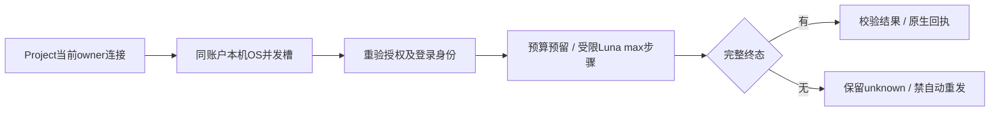

# Codex Luna运行时G2收敛验收

2026-10-14，G2在同一最终HEAD 8c234ac09351080ce457840b834af5d6ac3d57a1全部PR门禁及两路复核通过后，运行时 [PR226](https://github.com/FengHuoLinShan/ai-writing-assist/pull/226) 已合入main **d904eb8d15b66a59653a978d517608f7c7fcaded**（14:05:33+08:00）。squash树与受验HEAD逐文件相同；未部署。《诡秘》全量仍暂停，自动任务60保持删除。

W8的118份改动已迁入PR222之后的主干。七个旧树逐路径比较：54处内容变化、6处新增文件存在性变化；全部版本保留，裁定记录见 [差异表](../../.agent/tasks/2026/T-20261014-codex-luna-convergence/OLD-TREE-REVIEW.json)。保留PR222的服务拆分、消费者输入证明和教师/holdout暂停守卫；移除已退休、无调用且引用失效名称的旧私有helper。模型规则独立 [PR225](https://github.com/FengHuoLinShan/ai-writing-assist/pull/225) 已在全部CI通过后合入main（e02137f79fc4e8f5ba4f79f541b66b5dbaa47a05）。

## 当前行为与证据

- 仅本机单用户bootstrap owner可验证并使用原生Luna/max。连接绑定当前ChatGPT登录账户哈希及CLI/home身份，注销、替换账户和API登录失败关闭，同账户Token刷新可继续。每次请求在预留前回读当前owner连接，已打开客户端也不能越过断开。
- codex-text-v3快照显式保存包装版本和固定指令SHA256，额外配置继续哈希绑定。旧/缺失包装和local_agent文本快照不续跑，历史回执不改写。
- 账户并发默认2，合法整数1—8；同一系统用户/同一ChatGPT登录在本机API/worker共享OS槽，等待先于预算预留和provider超时且受run deadline约束。配置漂移且有在途时拒绝，取消/进程死亡释放槽。API供应商的既有调优和串行规则保留。10个真实子进程在2/6/8配置下分别达对应峰值且不超额；这是机械并发证据。
- future CLI诊断仅保存实际退出码、turn事件、adapter主动停止标志及固定原因分类，传至客户端和连接验证；原始stderr、事件、Token不进入这些字段。unknown仍不可自动重发，没有补造回执或使用量。
- 原生导入预检只核验当前作品授权、已验证连接、登录身份与Luna/max/包装，明确为本机配置检查（remote_check=false），不发送额外模型探针。账户设置的显式验证仍发送真实探针，保留未知分类与安全诊断。
- 继承的容量/恢复修复保留：历史主题有界证据包、无可执行动作免发证明、独立发现窗口及严格前序身份、并发journal原子合并、已完成深度场景来源前缀复用、跨章working跨度和P14v6候选关系引用。缺口确认只改变作者授权的可选发现范围，永久标未检查，保留原unknown；未用于暂停的Guimi项目。

## 验证范围

| 层级 | 当前证据 | 边界 |
|---|---|---|
| 后端扩大回归 | 3204 passed、3 real/external deselected，1既有OpenAPI默认值告警 | SQLite/离线及真实OS子进程；不代表文学验收 |
| PG锁/领域恢复 | 9项通过：稀疏/六路/未知/中断窗口、精确缺口/来源漂移/同伴未知/租约/日志漂移 | guimi60_identity_parallel_test专用合成项目，零模型调用 |
| PG迁移与降级 | 全新建库升级、2项约束、长类别往返、2项危险降级拒绝、安全降级/升级、alembic check均通过 | 新建codex_luna_g2_migration_test，不迁移旧运行库 |
| 前端 | 最终3文件40项Vitest通过，受影响组件/测试/E2E的ESLint通过 | 不等于真实用户操作或完整浏览器验收 |
| 新原生模型探针 | 3次请求：一次真实账户验证，两项新合成业务，均完成；两业务预期全匹配 | 经Project普通入口/冻结快照，无工具执行、无付费回退；未重复旧case/hash |

两业务CLI退出码均0，turn.started和turn.completed均观察到，耗时10.91/11.62秒；两项并行是小样本功能检查，不能据此宣布长篇提速或六路稳定。首次v3验证在provider构造前因平台auth.json为0644被新检查拒绝；堆栈和代码证明零模型I/O，原marker原样保留，兼容修复后才首次执行实际验证与尚未启动的业务case。原生请求原始内容仅留仓库外私有目录；本报告不统计Luna费用/额度。

## 仍未解决的原任务问题

旧约1.91秒unknown没有退出码/turn事件，存在宿主受限环境差异，原因仍未定。官方 [非交互执行文档](https://learn.chatgpt.com/docs/non-interactive-mode) 说明JSON事件与ephemeral不保存rollout的边界，不能补出原答案。这次新诊断仅提高未来可观察性。

《诡秘》深度done/degraded，演化仍8/63且原第9单元unknown保留。全量比较、用户操作量与直观性实测、来源语义准确率、长篇容量和稳定高并发未完成；不做两引擎最终排名，不宣称作者/人类验收。v3身份与包装门禁会拒绝旧v2续跑，恢复须另有合法版本/来源处理，不能改stamp或换hash绕过。

本次不清理旧八树、不修改原验收库和付费账本、不部署、不向其他线程/外部发送消息。证据与下一步见 [主任务](../../.agent/tasks/2026/T-20261014-codex-luna-convergence/TASK.md)。

模块导入门禁起初发现两处新增函数内跨域导入，已合并为既有Story facade消费；未改棘轮基线。门禁恢复524/524、65/65有向边，零顶层双向对。扩大回归初始旧手构造客户端夹具遗漏授权字段已修复；最终3204项通过。纯格式引入的8份无关文件已逐一验证AST相同后恢复，无旧WIP丢弃。

收敛后的演化模块窄复验517项通过；新增历史读取测试已通过：旧local_agent文字快照拒绝恢复，正常任务GET仍返回原合成回执，未发模型请求。该补测已包含项目文件12项中，不与3204项重复累计。Ruff、差异空白、文档影响和模块依赖门禁通过。

最终调用链审查补齐：Codex Project客户端缺少novel_id在provider创建前拒绝；错误模型/档位/包装在预算预留前拒绝，普通/流式均测试零预留、零I/O。受影响LLM/Project/Imports最终1554项通过（大部分已含于3204，不累计相加），新增历史/范围/错误模型断言单列。原生成功路径及指令未变，不追加已完成探针。

六种模型/档位/包装×普通/流式拒绝补测暴露配置错误被误计入熔断；已将确定性Codex配置拒绝排除出可用性失败，真实未知故障仍保留。最终LLM全模块及Codex项目契约451项通过，2真实模型deselected；不与此前回归累计。

Code Review两路固定904530e发现Standards两项P2和Spec一项P1，记录见[复核](../../.agent/tasks/2026/T-20261014-codex-luna-convergence/REVIEW.md)：独立图片Key被文本选择隐藏、导入预检丢原生未知证据并可重复验证探针。已恢复图片表单独立性，并将原生预检改为零模型请求的配置/当前授权检查；7种正常/漂移配置各重复两次均不派发，撤销授权关闭客户端。账户CI8个失败另暴露旧列表顺序/默认假设及断开后active选择状态变化，已按provider身份断言并恢复原选择契约，未放宽连接、owner或Kimi门禁。

最终受影响LLM/Imports/Project/账户偏好1619项通过、2真实模型deselected、1既有OpenAPIwarning；最后精简预检失败回传后121项专用复验通过。最终前端40项通过。地图浏览器两份失败现场分别恢复专注/编辑两种合法状态；原用例固定入口不可靠，现等待当前展开或编辑入口，仅在需要时展开，原位移持久化、创建城市图等断言保留，地图生产代码未改。全部新增修复已通过最终8c234ac同HEAD远端CI及两路修后复核；此前失败版本保留，不以其它门禁掩盖失败。

修复版abb5b968远端后端7962 passed/2 skipped、覆盖率86.84%，部署合同272项和PG均通过；这些记录属于该固定版本。该版本的浏览器shard1仍失败，作为历史证据保留；最终8c234ac同HEAD全部CI已通过。

## 最终签收

同HEAD 8c234ac09351080ce457840b834af5d6ac3d57a1远端CI：后端7962 passed/2 skipped/12 warnings、覆盖率86.84%；部署合同272、PG critical95；前端237文件2982测试；功能浏览器189+151、WebKit12、助手1、前瞻9、审稿9全部通过。CodeQL、镜像合同、文档和仓库门禁均通过。不同范围及重叠集合不累计；合成模型浏览器套件不是真实模型文学验收。固定检查汇总在/tmp/codex-luna-g2/ci-checks-8c234ac-final.json，运行时合并证明为pr226-merge-proof.json。

两路复核最终分别零剩余发现，见[完整复核](../../.agent/tasks/2026/T-20261014-codex-luna-convergence/REVIEW.md)。main d904eb8d15b66a59653a978d517608f7c7fcaded的六个push工作流均已成功，[main前端CI](https://github.com/FengHuoLinShan/ai-writing-assist/actions/runs/38520202070)完成全部单元、功能浏览器两分片及聚合检查。八旧树789份已记录文件版本合并后重验零漂移，均保留；原请求、unknown、账本与原验收库没有修改。

最终交接见[HANDOFF](../../.agent/tasks/2026/T-20261014-codex-luna-convergence/HANDOFF.md)。用户明确要求把最终签收文档推送合入；本次五份文档及关闭索引经独立文档PR交付，运行时/权威文档已随PR226合入，未另建运行时PR。Guimi v2不能静默续跑到v3，长篇全量/准确度/高并发稳定性仍未验，旧约1.91秒未知原因未定。

最终主干核验：2026-10-14T14:28:08+08:00。main前端237文件/2982测试、功能浏览器189+151、WebKit12、助手1、前瞻9、审稿9均通过，聚合工作流结论success。证据为main-frontend-final-proof.json、main-runtime-ci-final-proof.json与main-*-final.log（私有/tmp/codex-luna-g2）。这是既有CI结果核验，没有重新触发旧小说请求。
