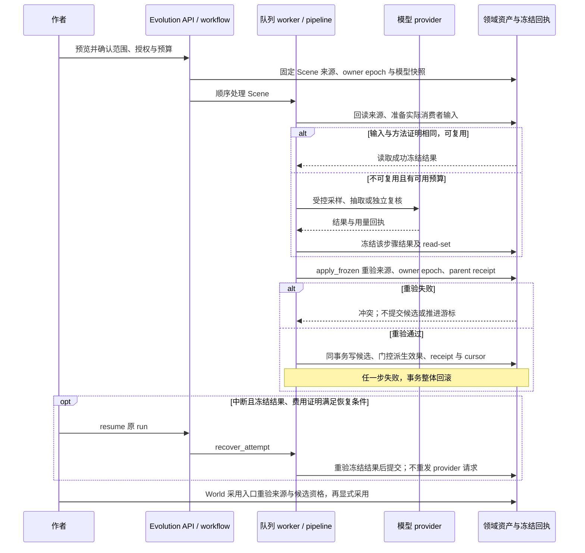

# Module: evolution / 演化系统模块

`ObservationModality` 的七种值统一定义于 `shared.observation`，本模块 contracts 保持
原名再出口。类型共享不改变观察 wire、稳定身份或回执版本；地图与其他消费者不得另造
不兼容的置信度枚举。

第三阶段实施入口见 [作者全景、细节台账与持续发现计划](../plans/2026-10-08-world-evolution-phase3.md)。
当前新增 `ledger_contracts.py` 定义派生主题、逐字证据/发生实例、修订变化包和独立作者决定，
以及主题/不可变修订的 ORM 与迁移；`discovery.py` 已接逐场理解和原请求冻结/预算，
`ledger.py` 提供作者全景、历史条目、逐字来源和判断读写。`EvolutionPanorama.vue` 在
写作侧栏及场景工作台接入表格、截止场景、来源、历史和作者判断；阶段验收仍在进行。
World 候选采用现重验实际传递回执前缀（含继承），避免 drained/stopped 旧运行遗漏前序来源变化。
append 保留已完成结构批次与游标，重新开放新增场景范围的结构阶段。
Assistant v8 A1 的 `evolution.prepare_reading` 仅返回 `workflow.preview_reading` 的授权预览，
不启动任务或模型；正式阅读仍由 Evolution 工作台独立确认。空间阅读/补扫的既有准备入口不变。

V4 长期计划（`docs/plans/novelcraft-v4/plans/01-EVOLUTION.md`）的演化引擎：
"读取正文 → 观察 → 身份解析 → 状态解释 → 校验 → 窄批次提交"的运行所有权。
当前已有持久化单 Scene 管线、冻结恢复、队列 handler 和正文/场景变更失效。
默认导入入口仍由 deep_import 编排；项目级旧/新 owner 门禁已落地并经原生 PG
验证。入口替代、观察期与真实质量验收仍未完成，旧编排尚未退役。

## 契约层（`contracts.py` / `observations.py`）

评测只读入口 `read_map_spatial_evaluation_receipts(db, novel_id, run_key, operation_id, scene_ids)`
经 owner 门禁校验实际空间阅读/补扫授权及请求 Scene 范围，返回冻结来源、空间覆盖与调用 journal、持久提交回执。
不核对并修改任务，不返回项目配置或凭据。主阅读未保存逐授权 attempt 映射时标记 `operation_binding_status=unknown`；
没有 attempt 的 Scene 覆盖同样标记 unknown，不能将缺失回执视为零调用或已完成。

- `SourceRevisionRef`：不可变来源引用。range_hash 由 content_hash + 偏移确定性
  推导；章节序号只用于展示排序，来源身份由 draft/content_hash/revision 承担——
  同字数替换、复制、恢复旧稿都产生可识别变化。
- `ObservationEnvelope`：原文观察外壳。modality 区分观察到的事件、角色陈述、
  信念、假设、作者规划、比喻与非字面、不明确；逐字证据必须携带自己的来源范围；
  未解析提及保留 `MentionRef` 身份并记录原因，禁止为凑 schema 伪造实体 UUID。
- `IdentityResolution`：reuse / new_candidate / ambiguous / unrelated 四态；
  reuse 必须带候选证据，ambiguous 必须有两个以上候选。身份去重与观察积累分离
  ——命中已有身份不跳过新观察。
- `TypedStateOperation`：类型化状态操作。location.observe 与 location.move 分离
  （后者需移动证据）；knowledge.* 必须指明认知主体；`documentary_assertion`
  承载尚不能安全投影的观察且不改变核心状态；前值未知允许 before 为空（assert
  语义），不得伪造前值。
- `EvolutionReceipt` + `CommittedPrefix`：跨模块交接回执与已提交前缀游标。
  failed / blocked / unknown_billing 的回执 committed_prefix 必须等于前值且
  不得倒退——游标只在领域提交成功后推进；coverage 按 inspected / not_run /
  unknown / excluded / stale / unsupported 分列，局部完成不折叠成全量完成。
- 稳定观察身份（`derive_observation_id`）：来源范围 + 观察语义 + 契约版本的
  sha256，不含输出位置与 run id——批次重排/合并不重建身份（T06），另一 run
  同断言去重，契约版本提升产生新一代观察并保留旧身份可对照。

- 窄提交协调器（E03c，`commit.py`）：freeze → apply 两段协议。模型返回后
  先冻结负载；apply 短事务内重验 owner epoch、来源 manifest 与父回执，
  任一漂移抛 `CommitConflictError` 作废重准备；领域写入由注入 applier 完成，
  回执持久化后游标才推进；同 attempt 重入重放原回执不重复写入（T10/T11
  故障注入测试覆盖：持久化失败复用冻结不重采样、响应丢失重放原回执）。
  存储经 `AttemptStore` port 注入，由 `PostgresAttemptStore` 持久化。

- 持久化与编排（E04，`models.py` / `store.py` / `orchestrator.py`）：
  `evolution_runs`（owner epoch、已提交前缀游标、根预算）、
  `evolution_frozen_attempts`、`evolution_receipts` 三表与 Alembic 迁移
  `20260921_evolution_tables`；`PostgresAttemptStore` 绑定 `(db, novel_id)`
  作用域实现 AttemptStore 协议——回执落库同事务推进游标与 head（不可改写），
  `reserve_budget` 条件 UPDATE 原子预留（T21 不透支）。编排内核：
  `prepare_scene_input` 前序屏障（T07：Scene N+1 输入实际包含 Scene N 的
  已提交回执；前序未提交显式 blocked，不携带假结论）；前序状态内容为
  **结构化观察**（A04，2026-09-22 审查）：覆盖最近
  `PRIOR_OBSERVATION_WINDOW` 个已提交 Scene，保留 modality/主体/来源
  Scene——传闻在下一 Scene 输入里仍是传闻，窗口与截断在
  `previous_observations_coverage` 显式披露（未注入不等于不存在）；
  `plan_parallel_batches`
  确定性准入（同 Scene 依赖键不相交可并行；键冲突或叙事顺序强制分批，
  不采信模型自称可并行）。注册的 Scene handler 已接此路径；默认导入尚未切换，
  不允许把显式演化任务与旧导入同时用于同一项目的正式写入。

- 失效传播（E05，`invalidation.py`）：`compute_source_change` 物理差异
  （同字数替换也给出非空受影响窗口，T08）；`apply_source_invalidation`
  传播正文变更——证据索引换源重建（旧结果不再显示有效）+ 按 source 立即清理
  RP 派生缓存行（M4：`purge_interaction_source_cache`，不等 TTL；清理失败降级
  记回执、TTL 兜底）+ Scene 派生投影
  软 supersede：登记覆盖完整时只失效受影响的 Scene×维度 checkpoint 与对应派生事件；
  缺少任一维度登记时，从受影响章锚定的最早 Scene 起保守失效。聚合快照仍从影响范围
  失效；作者确认/人工 checkpoint 不改内容，保留为 `needs_revalidation` 并在状态视图显示待重验；
  `apply_scene_reorder_invalidation` 处理场景重排（事件序号对齐 + 从最早
  移动 Scene 起失效）。Writing 的 working/published 保存、回退、删除及 Story
  场景更新/撤销/融合/拆分/重排均接相同边界；派生事件标 source_stale，演化 run
  推进 epoch 并记录待重算范围，不自动发起付费重算。作者确认与已提交回执保留。
  地图直接重读 Story 合法事件，不维护第二份事实；`world_knowledge` 在每次 Story 读取时按当前
  ReaderRevealPolicy 重判。Map Atlas 当前已保存版本的正文来源已有建议性核对；其余来源与 `world_canon_revision` 仍在回执
  显式列为 unsupported，不以局部完成冒充全量失效。状态视图侧的读时基线比对
  见 [M4 契约](../plans/2026-10-07-m4-dependency-invalidation-contract.md)。
- 消费登记与影响评估（P2-C，`consumption.py`/`registration.py`/`impact.py`）：
  `ConsumptionRecord` 契约内嵌产物行 `state_json["_consumption_registry"]`（不加表，
  随 supersede 软删，旧数据读取退化为空）；`assess_source_impact` 纯函数按登记细化
  受影响消费者列表（reason 机器可读 `anchored_chapter_edited`/
  `conservative_expansion_unregistered` + basis known/unknown），无登记/登记缺失与
  现状保守行为逐位一致、unknown 恒不收窄；无真实登记时按 outline 锚定结构合成
  整章消费登记（`anchored-scene-implicit-v1`，真实登记优先）。`InvalidationReceipt`
  增量字段 `affected`/`unknown_scope`/`receipt_id`/`recompute_options`（三分类
  reload_evidence/rebuild_derived_state/regenerate_prose；regenerate 恒
  author_choice_only），经 DI 键 `EVOLUTION_INVALIDATION_RECEIPT_VIEW`（`receipt_view`）
  提供 scene 级公共视图，Writing 保存链路消费（见 [11_writing](11_writing.md)）。
  Story 投影逐维度登记本场与继承前缀。登记覆盖完整时按变更偏移命中字段与下游 Scene，
  只 supersede 命中的 checkpoint/派生事件；缺维度、缺场景或旧格式仍保守扩大。聚合快照
  保留较宽失效范围以避免把混合维度快照当新鲜。
  回执指纹包含失效消费者的来源摘要，连续相同长度但不同正文的改稿不会共用提示编号。

- 场景步管线（G2，`pipeline.py`）：`run_scene_step` 按 §4.1 顺序组合——
  前序屏障（T07）→ 预算原子预留（T21，先预留再采样）→ provider 采样
  （sampler 注入，事务外；生产接项目 LLM 入口）→ 稳定观察 → E02 身份
  解析 → 冻结（T10）→ 窄提交（E03c/E04）。来源绑定（A02，2026-09-22
  审查）携带草稿内码点区间：整稿指纹与 Scene 区间分别验证，服务端按
  权威草稿切片逐字比对 scene_text——同一章可分多 Scene；观察偏移映射
  回草稿绝对空间；跨章使用 additional_sources（最多 16 段），全量重验
  且不插入无来源分隔符。引用重复时须显式码点范围；虚构/越界/错位引用
  在编译阶段失败关闭，sampled 结果与计量保留。跨章引用拆成精确来源链，
  观察身份绑定所有区间。跨章 Scene 的原子事件在末章生效；Story 事件
  snapshot_after.meta 保留证据身份。已注册 evolution_scene_step_v2 handler，
  尚未重定向生产导入入口，deep_import 仍持有旧编排。
  生产 sampler 只对 Scene 中唯一的逐字引文校准码点偏移，保留模型原范围和宿主
  `exact-unique-scene/v1` 对齐回执；重叠重复、缺失引文仍严格拒绝，不修改旧冻结失败。
- 理解读取（`reading.py`，经 facade 导出 `read_committed_understanding`）：只消费
  live 成功回执的完整连续前缀，重验父回执、Scene 映射、全部递归正文根与同 Scene
  最新回执。保留原观察模态、逐字引用与稳定身份，不带入当前 World 的额外事实。
  默认最多读取八个 run、每 run 二百步、返回三条理解；超范围显式列为未覆盖。
  已冻结引用按原身份重验，无关后续提交不使它失效；重算同 Scene 不复活旧理解。
  Evidence 将该只读投影放入实际授权 InputManifest，Collaboration 留存其传递依赖。
- 建议有效性缝（G2，`consumers.py`）：`check_suggestion_validity` 按证据
  索引指纹判定（T17）——新来源已请求未重建、或声称指纹与当前索引不符
  即失效；来源一致才保持有效资格；无状态返回 unknown。失效回执已把
  assistant_suggestion_validity 列为可检查项；当前仍无 Assistant 生产调用方，
  不能把内核测试等同前端建议失效已接线。
- 在场投影（G2，story/continuity/presence.py，经 story facade
  `project_scene_presence` 导出）：从已提交事件推导 confirmed_in_scene /
  last_observed 与路线段——仅当后一事件自带移动来源证据才标 traveled，
  否则 unknown（T03：不造路程/方式/时间）。仅投影当前有效 Scene，保留已撤销场景
  的作者历史但不回流当前位置。World 的 MapSceneContext 生产接口消费该 DTO，按
  对象身份匹配地图位置并保留原文回读引用；不占地图几何或创建另一份事实源。

- 恢复与 fencing（E06，`recovery.py`）：`replay_committed_prefix`
  键集分页有界重放已提交回执链（链缺口 fail-closed、检查点信任锚跳过
  早期页）；`verify_run_checkpoint` 校验游标与 head 一致性并执行恢复期
  owner fence；`store.save_receipt` 以 epoch 条件更新完成 T12 完整
  fencing（旧 worker 回执在持久化边界被拒，游标不动）。性能测量工具
  `tools/evolution_checkpoint_bench.py` 与 1k/5k/10k 档位结果见
  `docs/plans/novelcraft-v4/e06/E06-恢复与性能测量.md`。

- 迁移切换（E07，`ownership.py` / `compat.py` / `tasks.py` / `legacy_adapter.py`）：
  影子运行 `execution_mode=shadow`（迁移 `20260921_evolution_shadow`）——
  执行模式盖章进冻结负载，首次执行与恢复经同一写入策略解析强制替换为
  隔离 applier（即使调用方传入会写正式表的 applier），提交边界
  `apply_frozen` 亦拒绝影子负载的正式领域写（2026-09-22 审查 A01），不
  产生第二套有效事实，影子回执留在 evolution 自己的表里供对比。
  `ownership.switch_project_engine` 先持 Project 独占锁，按 expected_epoch
  排空或明确停止 Imports 与 live Evolution run，撤销理解队列/lease，再推进
  项目 owner epoch 与 schema floor。入队、恢复、预算和提交均重验冻结 token；
  预算及历史不清零。迁移 `20260922_understanding_owner` 以 PG trigger 拒绝
  旧 SQL 写入；触发器的 Project share 锁用 NOWAIT，避免旧心跳锁序死锁。
  全部旧 v1 任务（含 shadow）拒绝续写，新任务协议为 `evolution_scene_step_v2`，
  防止旧二进制复用新任务 token。已有 live run 的项目迁为 read_only，旧队列项
  在建立 guard 前取消，避免最早 pending 卡住其他项目。schema floor 升至 2 后
  禁止切回 legacy/downgrade，可暂停并由兼容新版恢复。
  在途兼容分类保留费用，从可验证批次继续；v2 handler 走真实
  路径（生产采样经项目账户入口；请求可带
  章稿内码点区间，scene_id 与章号经 outline_state 权威校验——A02；恢复
  优先含**任意已提交 Scene** 的幂等重放，按稳定请求身份
  `compute_scene_manifest_hash`（run/scene/正文/整稿版本/区间）判定，
  同请求重试拿原回执不重采样不扣费，修订请求指纹不同不套用旧回执
  ——A08）；deep_import
  入口适配层返回真实新回执形状 + deprecation 提示（实际路由重定向待
  canary）。E08 退役登记表见
  `docs/plans/novelcraft-v4/e08/E08-退役登记表.md`（核销条件满足前不删码）。

- 生产采样器（E09 第一步，`llm_sampler.py`）：首次入队经 Project facade 冻结
  secret-free `llm_snapshot_json`，``ProjectLLMSampler`` 经
  ``open_project_snapshot_llm_client`` 读取原 provider/model 与当前轮换 Key；账户
  默认连接变化不改写同一 run。旧 run 没有快照时允许冻结回执重放，拒绝新付费步，
  不猜补历史连接。一次 Scene 预留至多一次请求，禁用内部修复和传输重试；输出为 Pydantic
  schema 化窄观察（modality 七态/提及禁造 UUID/引用必须来自原文，校验
  失败即失败；scene_events 状态提议须引用本批观察序号 `source_observation_indices`
  作证据，knowledge 提议须带 `knowledge_subject`——经 `state_gate.py`
  语义门验证，2026-09-22 审查 A03）；Prompt 确定性注入正文与前序已提交
  回执身份（T07 注入面）；每次调用记录 paid_call_receipt 进入冻结负载可
  审计（任一尝试用量未知则总量 None + `usage_complete`/`unknown_attempts`
  显式留痕；最终失败也固化 failed_final 回执——A06/A07）。生产 provider
  ``project_llm`` 已注册到采样器注册表；真实模型验收单独授权执行，
  单元验证用冻结 fixture 客户端（不联网）。
  状态主体可使用 `subject_surface`；宿主只在引用观察实际解析的身份中消歧。
  全部引用必须满足主体与模态要求，混合传闻不能升级完整知识。机器状态负载还须通过
  Story 的实际物化 schema 校验，知识主体/稳定记录身份由宿主填写；不合法提议留在
  pending。此结构门只防类型、身份和模态越权，不能代替语义蕴含与否定句质量验收。

## 受控逐场景理解入口

`/api/evolution/engine` 由项目 owner 显式启用或暂停；`/reading/preview` 只读预览，
`POST /reading` 按确认指纹启动，`GET /reading` 读取进度，
`/reading/{run_key}/resume` 恢复同一任务。编排位于 `workflow.py`，沿用
`evolution_scene_step_v2` 与原队列、预算和回执。当前入口接受 bootstrap/append，
复用完整连续 Scene 前缀；未整理的正文末尾先经 Imports facade 的纯规划、切分、精确
定位及提交准备边界，不创建旧导入 owner。不跳过中间未映射章节、不猜测歧义范围。

`reading_plan_json` 保存每步 draft/hash/offset、Scene 顺序、操作身份和分段授权；
确认时重读来源、模型与项目 epoch。网络未知重试返回原任务，新 append 或额度耗尽后的 continue 授权才加预算。
下一 Scene 仅在上一回执提交后入队；队列元数据再绑定来源版本，未采样章节修改也会
封锁旧计划。历史读取不发模型请求，同一 run 始终使用原模型快照。

领域提交异常或服务器中断后，handler 先回滚领域事务，再经 Worker 的独立租约检查点
持久化恢复资格；已冻结 sampled/compiled 或已提交回执免费重放。费用未知的 sampling/
failed 结果不直接重试。作者暂停/owner 撤销使租约失效，不能复活任务。
场景准备使用同一 v2 队列的 prepare_scenes 操作，逐次请求先预留、冻结再调用，
SDK/结构化隐式重试关闭。已冻结结果重放不扣费，预算不足停下，旧任务终态后才可追加
授权；历次 preparation 请求/响应/用量不因 append 丢失。模型数组顺序不能成为 Scene
顺序，宿主按精确正文位置排序并校验读取顺序。整章兜底、未闭合右边界、未解决左承接
及低于 0.90 的边界置信留为待审草稿，人工确认后恢复；可选语义缺项不阻塞读取。
前一章尾部仅用于边界判断，固定 draft/hash 并参加失效，不作为本 Scene 新事实来源。
结果保存遵循 Project → run 锁序，改稿与 provider 返回并发时仍保留已付费结果、禁止应用。
`revise` 从正文/Scene 首个变化处重算；只有本次重读前缀中每个 Scene 的语义状态指纹与观察来源映射
都和基线一致，且来源仍当前、回执依赖链连续，才继承旧后缀并记录读取时重验的传播边界。
任一重读场语义变化、缺少指纹、旧链缺口或观察无法映射时继续保守重算；尚无完整消费 read-set
来安全跳过“边界相同但此前场景有变化”的情况。旧运行不回填指纹。`scoped_recompute` 接作者指定
Scene 起点，若前序变化则保守扩大。继承场景还须是当前最新成功结果；新 run 保存逐条
核实的原回执 run/attempt 身份、
游标和前序观察，旧冻结失败、历史与费用保留；旧任务未终结时不启动新 run。
对象/命题入口使用 `entity_id` 或 `observation_id`，与 Scene 起点互斥；目标来自本 run
已提交的冻结观察（包括继承的原回执）。`GET /reading/{run_key}/targets` 提供有界分页和
名称/观察文字检索，保持项目所有权与模态，未命中不证明不存在。预览以最早相关 Scene
及来源首变位置确定保守后缀，实际目标、起点和扩大说明一起进入确认指纹与分段授权。
这已覆盖目标选择、顺序编译和整场状态相等时的传播停止；P4 消费输入证明进一步在实际
Scene/Discovery/World 组执行点复用输入未变的调用结果，未知依赖继续保守重做。
World 正典修订、地图册非正文/待审来源与世界知识的来源版本失效闭包继续明确列为 unsupported，
不以读时可见性判断或调用复用冒充这些接线。

### 剧情结构阶段（Phase 3 迁移）

新 Reading plan 携带 `structure_version=1`（旧计划缺省 0，不追加费用）；`start_reading`
重建计划时保留 `structure_version` 与已持久化的 `structure` 阶段，已完成批次不因
追加额度/续读重跑。Scene 前缀提交完毕后经同一 v2 队列 `structure` 操作进入结构阶段：
每批最多 16 个已提交 Scene 经 Story 纯端口（`outline_state/reading_structure.py`，
复用 deep-import Phase 3 契约与 `imports.structure_analysis` 能力绑定）生成剧情线/
人物弧/伏笔候选，再按 Scene 正文分片独立证据复核。生成/复核请求不钉 model，由 run
冻结的模型连接解析默认；候选摘要超出 4000 字复核窗口直接失败关闭为待核对草稿，不物化
未复核结论。复核通过的批次以 `needs_review` Story 草稿持久化并登记
`evolution_structure_ref`；故事大纲四类结构资产（剧情线/人物弧/伏笔/揭示）采用时
重验原回执与最新来源，来源漂移拒绝采用，已采用条目回归作者自由编辑。
揭示主题若没有可验证的既有对象目标，不猜测目标，也不写入需目标 ID 的 RevealPlan；
批次回执保留原候选、逐 Scene 证据与 `unresolved_reveal_target` 待复核标记。
作者可从 `GET /api/evolution/reading` 的 `run.structure_review` 读取未解析数量、
具体条目及来源回执。流程 `completed` 表示阅读阶段结束，待复核揭示仍需作者处理。

## 测试

`modules/evolution/tests/`：契约校验语义（含游标纪律）与稳定身份性质。

## 2026-09-22 实施复核

同 run 重试保持 mode/execution_mode 不变，冲突在采样前拒绝。未提交冻结恢复
必须核对本次请求指纹和已冻结的 Scene 身份；队列去重绑定完整请求而非正文前
64 字。新单区间请求沿用原 manifest 公式，历史回执仍可读取和幂等返回。

E05 已接实际正文与场景变更入口；已提交观察经 Evidence 进入独立 case，C01/C02
的持久理解进入后一个新 case 和作者写作前瞻，地图经 Story 生产读取。生产 handler
纵切见 `evals/v4_vertical_slice.py` 与 `test_g2_consumers.py`；真实模型另用
`evals/v4_live.py`，共享费用账本并保留失败。E07 项目门禁、旧任务恢复封锁、迁移与队列
互不阻塞已有原生 PG 验证；完整 G2、G3 与 E08 尚未达标。确定性 API/浏览器及
影子规模结果不替代模型语义质量或真实用户验收。见
[实施审查与后续顺序](../plans/novelcraft-v4/IMPLEMENTATION-AUDIT-20260922.md)。

采样契约区分 predicate 的语义概括与 quote 的连续逐字证据：quote 不得补主语、还原代词或改动连词。模型违反时保留冻结失败，不能通过放宽原文匹配推进前缀。

独立状态复核（`state_review.py`）：通过引用/类型门的候选仍不可写入正式状态。
新运行使用单独的 `evolution.state_review` 调用，完整回读当前 Scene，逐项检查
否定、条件、时态、主体、角色认知及移动来源；仅 supported 且有原文逐字依据才放行。
漏项、重复序号、无依据、矛盾或无法确定均保留为待决定候选，不产生状态效果。
复核输入绑定 attempt、来源、parent receipt、epoch、前序输入及全部候选，提交时再次
验证绑定。采样与复核各预留一次根预算、禁自动重试、各自冻结费用回执；采样后额度
不足显示 needs_budget，追加授权后只执行尚未调用的复核。复核结果已保存时免费恢复，
请求已发出但结果不明或最终失败则待核对，禁止重发。旧计划/冻结没有复核版本时不
自动增加付费步骤，其未复核状态提议进入待决定，历史已提交回执不改写。独立调用
降低自我确认风险，工程测试不等于真实模型语义质量通过。

新阅读计划还冻结 World 候选版本，逐 Scene 运行 Phase2a、别名/关系和独立复核；
具体请求/schema、费用与原输出保留，候选写入与理解回执原子提交。旧对象新描述不自动
覆盖；无截止证明的后文别名不用于前文身份解析。World 采用入口在短事务内回读候选
所绑定的真实回执和最新来源，正文变更后拒绝直接采用。作者可从理解入口分页查看
候选及原文证据；这尚不等于 Phase3/高质量融合和完整旧链迁移完成。

DeepSeek thinking 模型现按身份关联候选分组，每组只附带必要身份上下文和精确原文区间，
独立冻结请求、根预算预留和付费回执。组失败或单候选超限只阻断该组；通过组仍走原 World
候选写入门。其他模型继续整包审查。旧版整场 `capacity_deferred` 保持原冻结回执；作者可
先预览预计组数/调用数，再确认调用，补审记录保存在独立冻结记录中，不重新抽取或改写旧回执。
明确失败且没有未知调用时可继续原冻结 attempt；unknown 请求需人工核对，不允许重试。
来源变化、身份漂移或 unknown 请求仍阻断，未通过的候选继续待核。

World v2 在同场新身份经独立复核后冻结候选 UUID，状态复核在该绑定上进行；
World 候选、状态、关系物化快照和回执同事务提交。新身份未创建则不发布悬空状态，
同场同名竞争保持待决定。关系历史限定真实前缀回执（含继承），不从当前 World 描述
倒推历史，最多注入最近64个相关场景并明确范围。旧 v1/v0 运行保持原调用顺序。

#### 逐 Scene 候选、提交与恢复

图中的 World 抽取先于关系准备；关系请求只在存在身份候选时发送，之后才规划独立审查组。
`apply_frozen` 仅在重验通过后调用领域 applier；World 结果是待作者采用的 candidate，不是 Canon
assertion。unknown billing 不属于可安全恢复的冻结结果，须先人工核对，不能按正常恢复分支重发。

P4 的复用证明按消费者实际输入和方法逐项判断。`test_relation_history_uses_real_prefix_and_not_mutated_world_rows`
断言总调用数仍为 8，且 scoped recompute 复用 sample、World、relation 和审查组；测试中改动的当前
`EntityRelation` 行并不是 `relation_history` 的输入，实际冻结的关系前缀未变。因此该断言只证明固定
关系历史输入可复用，不证明关系历史内容变化后的失效行为。`test_world_group_exact_read_set_reuses_only_unaffected_group`
单独证明一个 World 审查组的 source read-set 改变时只重跑该组、另一未变组复用；这是审查组消费者的
输入变化反例，不是 `relation_history` 的反例。

### 缓存清理故障隔离

正文失效附带的 RP 缓存 purge 在 SAVEPOINT 内执行；真实 SQL 故障会回滚该清理并在失效回执明示，不使主事件/checkpoint 失效事务报成功却失效未落地。权限/来源重验独立于物理清理，旧缓存不能因清理失败获得使用资格。

## 第三阶段作者台账与持续发现（验收中）

`ReadingRequest.discover_details` 显式开启版本一发现；旧客户端默认关闭，append/continue
保持原版本。新阅读/重新核对的授权预览披露发现和独立复核共用根调用预算。
`ProjectLLMSampler.discover_details/review_discovery` 通过项目冻结账户连接执行严格输出，
每批调用在 `scene_discovery_*` journal 冻结并计量，未知计费不直接重发。

发现输入回读本场观察、来源合法的主题摘要和完整证据，以及按既有主题、World 已解析对象 ID、
最后字面名优先级排序且最多 64 条的历史候选，并披露被省略数量与实际召回范围。
作为召回来源的历史主题还须通过当前方法版本核验；方法过期的旧结果保留回看，不进入自动召回。
正文摘录按观察来源区间加邻接上下文裁切；整场较短时保留全文。主题与原始证据共同分批，不靠
最近三场窗口遗忘；超出单批容量明确 unsupported，
观察抽取本身的未覆盖也传递为 partial。只允许引用本批实际提供的观察与目标修订。
观察缺口须与已抽取的明确事实一致，不把明确未做误报为没有描写。发现输出按契约给出
逐类别覆盖；缺字段按未检查展示，失败、未检查、部分检查和“已检查未检出”分开。
无目标的独立疑问用new；question只更新本批完整既有主题，缺完整目标仅记待解。
完整历史主题及精确复核目标提供原证据用途/发生锚，默认继承已认证旧用途，不重新把旧物理
出现改选为背景。发生单位沿原具体细节：线索的解释和相关后续不同动作只作背景，不因新
声明扩大主题就再计一次；明确兑现仍可计入它对应的承诺。用途认证分歧整项保留待核实。
言语/知情归属须原句支持，叙述者说明不改成角色自述；回忆者与被回忆动作主体按整段
原文分开核定，不信派生谓词或最近名字。明确原文可明确识别的同一人物的原具体动作再现，可以
不同触发/姿势情境；确切物件同一性、机理及普遍性另列未知，不合并World资产，也不把
旧单次触发自动设为再次发生的必要条件。真实主体/动作歧义仍待核实。
禁止机械猜最近人物不禁止原段清楚共指；谓词/提及可依唯一先行主体及语法连续还原
原名，引用仍保留原代词，不把代词新造为人物。World资产新候选不等于文本主体未知，
明确人物的一次情境动作可作为supported单次事实，不要求先证明习惯或因果规律。
同一主题不同变化全部待核实；结构非法、引用不符、独立复核漏项不入台账。
格式/schema失败且用量完整已知时隔离整批、保留失败回执，明确未检查/partial；不把坏输出
落为派生资产，也不阻断其它已验证Scene资产。未知用量、权限/来源及非输出故障继续停止。

`evolution_ledger_entries/revisions` 仅存派生理解和不可变修订，不写 World/Story 正史。
主题 UUID 不随文案变化；发生实例、观察与来源分别计数，回忆不增新发生。
条件/背景证据不增加发生数，独立复核逐项确认实例；正向发生、同条件例外（exception_case）和反驳旧主张的反证（counterevidence）分别计数；
后来的未做不否定过去一次动作，未描写仍不能成为例外。独立复核分别确认实例、例外和反证 ID，
只有本轮明确负向/反驳证据可形成 exception 修订；未确认负向不得变为正向支持；来源抽取轮次为该条目历史中已绑定的唯一 run/attempt，
作者判断行、重复引文和独立复核请求不增加抽取轮次。
发生锚不可随追加引文改变。不确定更新另存候选并绑定原主题修订，不替换已获支持的
主题，也不作为下一轮的支持主题；无原目标的待核实新主题携带稳定身份、独立资格和
原始证据，后续可在新来源支持时复核。列表/详情展示复核结论、理由与此前获支持的理解。
关联对象来自原观察身份绑定（不是 World 当前版本），回读时重验当前身份匹配；
歧义、来源与方法变化分别展示，不覆盖作者判断或自动改变置信度。
作者默认对确切记录/场景/对象作判断，扩大主题作用域须显式确认。
instance判断不构成整个主题的次数上限，不禁止后续新来源支持的独立实例；
发现与复核提示均保留该作用域，复核直接引用宿主提供的change_index，漏项仍不放行。
主题摘要携带细节标签/主体与既有资格用于分批路由，不作为原文证据或跨批目标。

作者 API：GET `/api/evolution/panorama`、`/ledger`、`/ledger/{entry_id}`、
`/ledger/{entry_id}/evidence/{index}`，POST `/ledger/{entry_id}/decision`。
统一 owner/novel_id 和非只读演示门，角色/读者不读取台账或隐藏计数。
状态历史复用 Story author view；当前伏笔计划单列 plan，不冒充过去历史。
判断保存共用 project exclusive fence 与修订 CAS，exact operation 重放先于当前来源检查。
前端草稿本机与会话保留，保存失败/冲突仍可编辑，备份失败有离开保护与可复制输入。

世界组合候选的独立审查同时绑定首轮World身份上下文及后轮关系上下文/指纹；
World的可见身份声明核对首轮输入，关系核对后轮输入，不把后轮资料当首轮已提供。

独立发现复核的 `occurrence_observation_ids` 认证实例身份，包含合法回忆与本轮明确重新认证的旧源，不表示新增次数；次数仍按发生身份去重。旧 unknown 仅在本批实际可见、复核 supported、发生模态及引文/来源引用一致时升级新修订，旧已知锚和历史不改。同观察已经定位时不再重复计为未知。`context_observation_ids` 明确复核背景用途，纠正新证据误标实例；不从 reason 自由文本推断，也不把真正身份未定的实例改成背景。相关物件保管不表示线索再次出现，为履约准备不表示兑现。全局 uncertain 不改已认证背景用途，作者决定仍独立保留。

发现主张和独立复核须覆盖每个新增断言，包括只补背景且发生数不变的状态。未描写、等候或相关对象未到不证明未履行，望向某处不证明身在该处；角色陈述模态仅承载实际说出的内容。缺少来源支持的推断仅作为竞争解释或待核实提案，不因背景用途、不增次数或保留竞争解释而取得 supported 资格。

主题身份与事件共指、模态、传闻真伪及机理独立；已确定同主体同细节的转述沿原主题。背景证据也须有原文关联，共场、缺描写或未说明关联不能形成关联；独立复核先核主题及逐条相关性，再核断言/模态/实例。conditions表示有来源的实质追踪条件，单次触发、体征及姿态保留context与竞争解释；更新保留原条件及情境差别，不任取交集制造例外，instance不禁止后续独立负样本。

演化项目采样器经既有snapshot facade设置900秒有限调用上限，保留固定provider、当前账户Key、原model；窄观察仍禁thinking，涉及多源身份/修订/实例绑定的细节发现及独立复核复用已支持模型的max思考与393,216输出上限（含推理）。非支持模型保持其原配置；不启用全client高质量模式。SDK仍受更短run deadline约束，失败关闭及未知用量不重发不变。该设置只缓解已证实180秒取消风险，不宣称修复连接读取失败或保证900秒足够。

绑定11接受 event_observed 观察的精确宿主自锚，效果与省略/空锚由宿主计算相同；只限实际输入中的该条观察，其他ID仍走旧主题同场同源重叠门，recall、context及主观模态不得借自锚绕过。supported的新背景用途须由结构化context名单认证，counter/context亦可由独立反证名单认证；缺一项整条隔离，不从reason猜测、不删源后保留statement。继承已认证证据/旧锚不重认证，uncertain仍独立候选。共指只识别所指对象，不能自动证明持有、归属、位置、知情或因果关系；协议与语义门分别验证。

发现复核四份认证名单只能引用本项选择的观察，以及身份/修订匹配的
`target_theme.evidence_observation_ids` 所列精确继承来源；全批其余对照只用于理由，
不能补入名单或改变证据绑定。目标描述从既有主题精确绑定名单摘取，不使用包含同场
额外观察的对照集合。资料未描写仅报告覆盖/待解，不能改读为世界状态未发生。

Scene World身份入口复用World已批准的类型归一，查询、候选和冻结查询采用同一canonical类型；
等价别名先去重。`人物/角色/character_ref`归为character，地点归为location，物品归为item，
物体归为object；物件及自定义类型仍保留，不跨类型复用。旧冻结查询与新范围不等时仍失败关闭，
不把旧付费结果重算为通过。事实性新增限定须由本项绑定引文支持，含时间、位置与情境，
复核不能把全批未绑定句子的真实内容当成本项已引用的证明。

已有主题条件集合变化时，发现复核须提供`conditions_review`专用资格：supported、非空且本项绑定/本批实际可见的来源，并解释原实质条件如何保留或有源重释。缺资格整项待处理，不从整体supported/自由reason放行、不自动合并条件或补源；new与条件未变不增加门。生成目标/修订只复制本批完整theme，历史review/作者basis及theme_index不是写入目标；主张采用最小充分绑定内容。合法recall认证当前回忆动作并绑定原锚，名单不是新增次数，回忆触发/见证陈述只作背景。新方法指纹保留旧运行与作者决定，旧未知用量不重发。

单次情境中的外部触发不因曾写入conditions就自动成为必要门槛。后续若以原/新两侧
原文明示的对照状态或约束重释旧条件，生成须显式修订、保留原情境，复核须走既有
conditions_review；未获资格仍整项待核，不任取共享词凑例外。转述优先原姓名/原引语，
性别代词只取本项绑定原句，不由姓名、旧摘要或后文补签。覆盖/待核说明也保留原叙述
资格，与已明确观察一致；缺完整主题/World未入库不等于文本主体歧义。无完整目标的批次
不输出其更新，仍如实说明本批未处理范围，不猜旧修订或填写空目标占位。

发现批次（含无旧主题的首次批次）、完整主题、路由索引与精确修订复核目标共享宿主
`conditions_semantics` 字段定义，并纳入方法指纹。它定义追踪维度而非替来源宣告条件无关。
首个单例优先原文明示可对照的基础状态/约束，不把整个初次情境拼为必要合取门槛；
具体触发、程度与伴随体征仍留原事实/context及竞争解释，原文或作者明示限制仍须保留。
已有条件重释继续经绑定两侧来源的 conditions_review，不自动删条件或补源。
当前观察引用要求逐条变化执行；合法空变化无需引文，仍返回 coverage 与 coverage_note 如实记录覆盖。

原段明确同主体且情境连续的条件与动作可分处相邻观察；发现须共同绑定条件context
与动作occurrence，人物动作不因涉及物件就改为clue。独立复核核类别及绑定，
不以未选择的相邻来源补签、不由共场臆造条件关联。

类别按主题所追踪单位核定：明示可对照条件中的人物动作不能被物件clue替代；
同段有独立外观/符号/现象来源的额外clue仍可保留。已承诺的履行/违背沿原commitment，
不因也是人物动作改类，各单位独立计数。

回忆没有本场新动作不等于已证明指定旧event同一，仅唯一已存候选不证明全文唯一。
缺唯一原锚指认时保留recall/null并由宿主列未知实例，不增已定位发生；可能另次旧event
属关键锚歧义，不能认证原锚后只写竞争解释。当前方法指纹还固定DeepSeek长结构步骤
采用SDK原生SSE聚合，完整结束原因与最终usage齐全才进入原JSON/schema链，断流未知、
禁传输重发；其他模型及短observer调用保持既有路径。

绑定12为本轮新增的specific旧锚recall引入`recall_identity_reviews`逐pair资格：匹配当前回忆
观察与精确旧occurrence，supported证书两侧须是本项已选/继承且本批实际可见；旧侧必须且
只能包含一个该锚同用途/角色的原已定位event观察，新侧包含当前recall见证与指认context。
缺证书、重复、未确认或错误来源整项待核，不从reason推同一性或由宿主猜锚/改为unknown
来掩盖statement；无specific锚的recall/null仍未知且不增定位次数，继承已认证旧use不重要求。
复核target同时提供occurrences与旧用途以独立核pair，不把新句说无新动作当具体旧锚证明。
发现与复核仅对已支持DeepSeek使用已注册max思考/65,536输出上限（修复32,768全思考截断
的已证遗漏），仍不改变账户provider/model、预算请求数、免费恢复和未知不重发边界。
原文明确与动作相连的基础状态/约束进入追踪条件，外部触发不替代该状态；后续对照仍须
两侧来源专审，不默删原实质限制，不把条件维度当必要/充分或习惯。

绑定13额外保存宿主来源`occurrence_origin`（原提议类型）；继承unknown自动升级为event
仅允许原提议event且原引用/模态/本批可见/结构化认证均合格。未知回忆及旧无来源类型
的unknown不能仅靠正向名单变成新的物理发生，旧已认证known不重认证。后续显式重选
历史unknown recall可用双侧pair证书及本轮新增绑定指认context续证，原head不回算，
按同observation已证链接消未知，不增加旧物理发生；无本轮指认来源仍整项待核。

绑定14阻止已存回忆用途来源被模型重选为event产生新的物理锚；同主题回忆原观察/
相同引文与source_ref的重选仅能保留回忆/背景，合法链接续证仍经双侧pair证书。
question即使复核确认“问题有依据”，仍另存绑定原主题/修订的提案，不替换既有
已支持head或作者决定；这不是确认问题已有答案。所有proposal_target从自动支持
主题召回排除，初始无target uncertain仍可沿原ID在新来源中续证；详情保留原支持理解。
路由prior_review仅带verdict，不复制旧机器自由理由自证；完整主张、条件、作者决定、
原始观察/引用/用途与已知发生锚仍提供，未缩短历史窗口或删证据。

## ADR-0036 空间可选阅读步骤（M1）

`discover_details` 与 `discover_spatial` 按 `optional_steps.py` 的纯数据规格登记。
新建且开启空间发现的阅读计划冻结 `optional_stage_version=1`，确认启动时保留该版本；
Scene attempt 在首次请求前固定同版本及计划已授权的 `spatial_method_fingerprint`，采样后仍保留原值。
旧 run 的 append/continue 保持原阶段版本；新 recompute run 沿用其正式预览冻结的新协议。
主采样、身份、World 候选和状态在原事务内先提交不可变 Scene 回执；同一持久 Scene 任务随后
按 details、spatial 顺序执行可选阶段，再推进下一 Scene。可选 provider 慢或挂起时，其他会话已能读取
主回执和 World 结果。`optional_scene_stage` 关联 `receipt_attempt_id`、提交后的 Scene 指纹和
主状态指纹，各步骤记录 pending/running/complete/failed/unknown/not_run（关闭步骤为 not_run/step_disabled）；
可选领域结果和计费仍保存在
原 attempt 的 materialization/coverage/journal 中，完成后不改写主回执。恢复原任务时，已提交分支继续
未收尾阶段；sampling/failed 未知费用只记本步骤缺口，不重发，其他步骤与后续 Scene 继续。
阶段发送和物化前重验原 Scene 回执/head、owner、正文及提交后的 Scene 指纹；取消保留持久阶段待恢复。
主游标已推进但可选阶段未收尾时，进度不提前显示全部完成，append 不越过该阶段。
shadow 阶段明确标记 `not_run/shadow_isolated`，不写正式领域。补扫不复制原 Scene 的主提交阶段身份；
原可选阶段未收尾时先恢复原任务，原发现请求费用未知时禁止用类别补扫重发。
旧冻结负载、旧计划追加/继续均不升级此协议。

`discover_details` 的旧 API 默认、journal、方法版本和写入链保持原行为；空间步骤另用
`spatial_version=1`，API 开关默认关闭。新 UI 在授权预览显式提交开关，预览冻结空间子额度和
主理解必需请求保留额；空间运行中 `details` 与 `spatial` 各自扣独立子额度，任一步耗尽只记该步缺口。
`append`、`continue` 继承冻结版本和方法指纹，保留既有补扫 journal 登记与草图游标；
方法变化只记空间缺口，不能通过恢复或新补扫操作重发未核清请求。

空间抽取与复核分别使用 `scene_spatial_discovery` / `scene_spatial_review` journal，方法标识为
`evolution.spatial_discover.v1` / `evolution.spatial_review.v1`。调用前冻结当前 Scene 正文、身份候选、
项目空间类型与严格更早的线索，实际召回和省略数进入 consumer read-set；不读后续 Scene。
本场主回执后，空间端点可投影独立审查且已物化的 World 新候选，不依赖主 observation 是否列出该地点。World 按 owner/作品、原回执与当前来源前缀及同 run/Scene/index/attempt 的实体来源元数据重新验证，未物化、其他运行、未来场景或失效对象不进入输入。中文标准类型沿用正式类型归一化；真实地点端点可触发密度门，只有正文实际包含的名称才计数，不推测自定义对象类型。端点投影版本进入方法指纹，旧冻结保留原指纹并诚实报告 stale。

来源模式保持 Story 实际 `working` 或 `canonical`，引文必须在当前 Scene 正文唯一、逐字命中且落在一个
被绑定的源区间。模型给出的端点 ID 只在本批 World 输入中解析；未解析端点保留为文字待放置线索。
独立复核按提案与精确引文绑定；新类型首场只形成涌现草案，至少第二场的累计 prior+current 原文证据
全部经复核后才可提交激活提案。World stage 还会重验来源、端点和类型修订；写入的只是地图域线索候选，
不会写 World 关系或地图 head。空间失败、缺额度、未知请求、部分覆盖和来源冲突只影响该步骤覆盖，
未知 journal 不自动重发。输入超限与已落失败 journal 的 provider 异常保留为空间缺口；
主理解的 owner、来源或父回执冲突仍按原门禁拒绝。旧 Scene 的补扫 journal 不抵扣后续新 Scene 的主理解保留额。

覆盖汇总使用 `inspected`、`density_skipped`、`gap`、`not_checked` 四态，并保留可见的原因与覆盖信息；
不向界面暴露内部 journal key。旧阅读的空间补扫通过
`POST /reading/{run_key}/spatial-rescan-preview`、`spatial-rescan` 和
`spatial-rescan/{operation_id}/resume` 单独预览、确认和恢复。旧冻结来源没有 mode 时，分别按 Story
的工作稿/正式稿合同精确校验；只有唯一模式与冻结正文及范围相符才允许补扫。

阅读批次结束或补扫结束时，Evolution 聚合该运行截止 Scene 并经 `world.build_map_auto_drafts` 请求一次
幂等草图批次；每次调用有界推进，running 在相同 build key 下恢复下一片，completed 重放原结果。
失败或缺少构建 port 会保存可见状态，不把未构建算作完成。草图仍是作者审核候选，不自动保存或采用；
World 端负责依据同一 run、截止 Scene 和逐条重验后的可用线索构建候选。

## #209 派生账本读取与发现容量

`freshness.py` 缓存经过完整来源验证的前缀证明，以 PostgreSQL 事务内维护的
`evolution_source_epochs` project token 作快速守卫，发生写入时比较实际章节、Scene、
run 和 attempt 依赖 token。无关追加保留历史证明；正文换版/恢复、Scene 边界/重排、
最新成功尝试和继承范围变化不能误命中。缓存有界、按数据库 engine 与项目隔离，
缺 token 不缓存；完整验证前后的 project token 必须相同。只用于派生账本与发现读取，
正式 World 候选采用仍执行原完整验证。

`discovery_capacity.py` 用确定性正文窗口、原文偏移、主题/候选/索引分片替代每批完整
主题索引，保留全部召回候选。每项 new 还须经全部索引片的独立复核；冻结键
`scene_discovery_identity_{batch}_{shard}` 沿现有预算、来源门、费用与恢复协议，
缺失/不确定/重复/失败的资格不放行。覆盖率新增 `batch_scopes`、`theme_index_shards`、
`identity_review_gaps` 和 `identity_inspected`；单批实际 JSON ≤50000 字符，单个不可分
条目超限只影响对应片。方法指纹纳入分片协议与窗口参数，旧方法的冻结准备不静默升级。
产品接口、作者决定、正史权限和 #208 Scene Projection 消费查询保持原契约。

#209 缓存守卫先 flush 待写入数据，兼容生产 autoflush=False；详细证明以 scope 引用/令牌数限制总容量，超出预算仅保留当前项目 epoch 的快照，epoch 改变后完整重验。

### P4 离线续接：消费证明与类别补扫（2026-10-12）

Scene 采样及每个实际 `_run_scene_call` 消费点冻结 `consumer_read_set.v1`：实际输入各字段、
最终请求/响应 schema、Prompt、模型快照与真实 transport/options 的哈希。采样只对宿主
run/source/parent 与观察身份做有界重绑定，保留全部前序事实、模态、主体、Scene 锚、覆盖
与顺序；World 对象/关系 ID、旧 occurrence 锚、台账 ID/修订及作者决定保持原值。
Discovery 仅对完整来源/资格/身份相同的观察做一对一引用映射，重复或未知证明保守重做。

重新核对仍顺序编译当前场景并取得新的来源/parent/owner 回执，但每个实际消费者只在输入
或方法变化时重新调用。完全相同的已取回结果链接 `reused_from`，免预算/免调用，原付费
回执只留原调用；缺 read-set、sampling/failed、schema/Prompt/配置变化均不复用。
World 分组 scope 使用候选、来源及身份上下文的内容身份，组输入未变可独立复用；不复制
已物化正史或旧认证，所有独立复核输出仍在当前 scope 重物化。原整场语义相等的早停继承
继续保留。Story 按字段和实际区间登记失效。Story 的 `world_knowledge` 展示在每次读取时按当前
ReaderRevealPolicy 重判；这是读时披露策略检查，不等同于 Evolution 消费登记。地图册当前已保存
版本的已发布正文来源已有建议性核对（G8a），其非正文/待审来源与 `world_canon_revision` 仍未登记为
失效消费者，在回执中明确列为 unsupported；不能据局部输入缓存宣称这些来源已随 Story 变化自动
失效或重算。

`POST /reading/{run_key}/category-rescan-preview` 按已读 Scene 区间及类别注册表选类，
预览不发请求；`category-rescan` 绑定操作 ID、完整来源/方法/模型/预算指纹与作者确认。
显示基础调用估计与含身份去重的最高调用上限，根预算及本操作上限都在发送前扣减。
原理解任务、补审或补扫活跃时拒绝并发启动；来源变化先拒绝，不增加预算。
补扫单独冻结各场景发现/独立复核，只持久化选定类别的派生台账，不改原 Scene 回执、
游标或 World/Story 正史。覆盖分别回读最近一次选类扫描，未选类别保留原覆盖；失败、
未知结果、未检查与已检查未检出分开。`category-rescan/{operation_id}/resume` 仅恢复已核清
中断，已取回的结果不再调用；未知付费结果先核对。沿用现有 ReadingFlow 面板，离开后
回读操作状态，失联重试保留同一确认 ID，换作品隔离迟到响应。

本轮只作合成数据的离线工程验证；语言习惯/外在特征是当前新增类别，重要物件/规则后果
仍按原计划等待长篇分布裁定。P4-E 实际费用/质量、封存盲验与作者试用均未执行。

### 2026-10-13 真实语料发现容量修正

每个历史主题只装入自身全部绑定证据；历史候选仍独立保留，不把同场所有观察复制到每个主题。绑定来源可超出候选召回限额完整回读，并披露额外回读与未检范围。完整历史单元按实际剩余请求容量装包，保留12000字符复核余量；最终生成与复核JSON仍各自受50000字符门禁，巨大不可分来源不会静默裁剪。mention只省去重复宿主身份字段，不裁剪原句、模态、解析结论或说话归属。方法指纹纳入这些投影及装包语义，旧冻结准备不静默升级。真实冻结单元复放的容量改善属于工程证据，不代表完整小说或作者质量验收。

Codex文本运行的导入默认等待由Project snapshot处理，避免沿用API的360秒provider默认值；明确的作者时限和旧冻结参数保留。演化本身仍使用冻结调用与未知请求保护，不因等待延长放宽证据或世界审查。

### 2026-10-13 发现调用资格与耗时修正

“禁止新增主题且没有完整更新目标”的历史观察批次，按既有 _compile_change 与
DiscoveryChange 契约无法产生合法变更。仅在没有任何原调用/复核/身份审查日志时，
宿主冻结绑定同attempt、来源、父回执、方法和完整输入的无可执行变更证明，免发模型。
不新增模型回执或结算，原历史资料仍完整保留；coverage.no_action_batches 单列这些批次，
inspected 中标 not_checked/model_called=false，不宣称已检查历史语义。类别覆盖仍保守聚合。

已有已完成、在途或失败日志不被重新分类，也不因该证明跳过待核对门禁。编译重验
无新增权限、无完整主题、输入hash及日志缺席；证明漂移失败关闭。语义方法指纹、
Prompt/schema与可采用变更全集保持原契约，旧冻结准备原样复用；实际执行代码版本仍分别记录。
离线或真实冻结输入的资格分析不代表在途版本已提速，真实全量及文学质量另行验收。

### 跨章工作稿映射与正常恢复

Story 的工作稿 SceneSpan 按章节绑定；部分章节已有 working 映射不能表示整场来源已齐。
正常理解恢复逐条重验全部计划范围时，边界验证按 `part_no` 优先采用已有 working 部分，
只对缺少 working 的部分读取原 canonical 映射。已有 working 部分的失效或版本漂移不能
回退绕过；缺段、偏移或稿件身份不符仍失败关闭。原稿/冻结范围与回执不改，不补写映射。

### 独立主题身份分片的有限并行

仅原生 Codex 的同一新增主题批次身份分片按进程有限并发设置执行（默认两路）；每片读取同一冻结提案与各自
索引范围，不互相读取复核答案。其他提供方、生成/主复核和跨场景提交沿用原次序。
Project 连接初始化与同一 AsyncSession 的 journal 操作共享会话门，I/O 不持有该门。
结算按 Project→Run 锁序重新读取完整冻结负载，仅合并本片结果，不能以旧整包覆盖同伴。
未知、输入漂移与已完成结果仍走原恢复门；并发失败和正常 shutdown 先等待已发片真实
收尾，不重新结算、伪造结果或重复发出请求。每片必须保留原范围且通过独立身份门才能
采用，有限并行不构成额外调用预算或放宽 source/owner/lease 门禁。

### 独立模型池与 Luna 范围流水线（2026-10-14）

`LLM_MODEL_LIMITS_JSON` 按来源/provider/具体模型配置独立模型池，默认每池并发 8、RPM 0，
不再有跨模型总 semaphore 或全局 LLM RPM。键 `default` → `api/deepseek/*` 等 provider 默认
→ `subscription/codex/gpt-6-luna` 等精确型号依次覆盖；并发/输入预算为正整数，RPM 为非负整数。
普通、流式、修复与远程 embedding 按最终模型和实际 endpoint 归池。同宿主 API/worker 共享 OS 文件锁槽，
订阅池另绑定 ChatGPT 登录账户；配置改变等待本池已接纳请求结束，其他模型继续运行。
生产 API/worker 挂载同一私有 `llm-model-admission` 卷；本地使用系统用户私有目录。
RPM 是每模型的进程内 token bucket，默认关闭；正 RPM 部署仍按 worker 数核算 provider 总吞吐。
取消/进程死亡释放槽，排队受已有 run deadline 约束，provider timeout 不被删除。

新 Codex `gpt-6-luna` 能力配置声明总窗口 1,050,000、完整输入默认 500,000、输出预留 128,000、
额外安全余量 32,000。CLI 显式覆盖 `model_context_window=1050000`、
`model_auto_compact_token_limit=800000`，继续 `--ignore-user-config`，不修改桌面全局 catalog。
完整执行输入计量包括指令、历史/身份/证据、JSON 包封和 schema；为不可观测 CLI 宿主包封另在输入内预留 32,000。
未确认 tokenizer 映射时使用 UTF-8 字节上界，并在能力快照标明估算方法；这不是已实测输入能力。
500k 是输入上限；超过时拆包或明确延期，复核超限保留生成及必要证据为待核对，禁止静默截断。
其他 Luna 型号仍须单独登记。官方规格和配置定义见
[模型规格](https://developers.openai.com/api/docs/models/gpt-6-luna) 与
[配置参考](https://learn.chatgpt.com/docs/config-file/config-reference)。
能力快照/方法/consumer read-set 固定策略；旧快照、字符规则、请求和原回执不扩大或重新盖章。
订阅 500k 可用性、语义质量和持续高并发未实测。

新 author-confirmed Luna 确定性流水线用 `confirmed_scope`，完成本次确认范围，
不因固定请求数、累计 tokens 或金额暂停。AIRun envelope v2 显式记录模式、可空请求上限及范围指纹；
未声明额度或授权策略不能把空值当放行。范围模式限已验证的冻结 Luna 模型，新队列仍经 owner、来源、
active run 和 lease 检查；其他模型/有界 Agent 仍用有限预算，循环、工具和单次超时不变。
Evolution `budget_total`/`budget_remaining` 允许成对为空；旧有限行原子扣减、旧信封保持原版本。
存在范围数据时迁移拒绝降级。旧未跟踪队列明确保留领域预算 seam，不能冒充已完整跟踪。

新 Luna World 用 `world_version=3`，发现用 `discovery_version=2`；按对象/关系连通分量/来源分组，
完整请求计量取代新路径的 45k/50k 字符门及 8k/12k 分片。生成装包预留 128k 复核空间，最终复核重新计量。
旧 World 1/2、Discovery 1 的准备、方法指纹和字符规则保留，追加/恢复继承原授权；重新确认的新运行才采用新策略。
发现最多 `2p` 个活跃批次，共享 `p` 个调用槽，生成后主复核及就绪身份分片接续，不设波次屏障。
身份审查等待严格更早批号生成终态，只读更早提案，提案不成为事实；未来返回及后序 Scene 不进入当前输入。
World 独立审查组与补审并行，普通理解、类别补扫、补审共用调用器/会话门。
日志重读合并、领域物化与 Scene 提交保留必要顺序。未知/权限/来源错误或取消停止新接纳，收齐已发请求；
已核清格式失败局部留缺口，已取回结果恢复不重发。旧 Codex v2/v3 的恢复限制不被绕过，《诡秘》保持暂停。
作者预览显示“完成本次确认范围”，DS 和旧运行继续显示调用额度。

World v3 审查准备含冻结 `context_snapshot`，即使分组相同，上下文策略改变仍拒绝恢复/补审复用。类别补扫继承原运行的预算模式；原新 Luna 场景未开启发现时，首次新授权补扫也使用 Discovery v2，旧能力快照继续 v1。范围/有限预算、安全迁移及合成场景验收纳入 PostgreSQL critical 门禁。

## 已发布正文变化与地图核对（G8a）

Writing 的 `published_changed` 在同事务内通过 `world.read_map_chapter_consumers` 只读 DI port
核对最多 200 个 saved current head 和 1000 条正文来源。node/revision 同时按 novel 过滤，
项目门禁验证当前 owner；Writing 的 `get_historical_source_identities` 仅投影同作品历史稿的
ID、章节、版本、content_hash、status 与 `deprecated_from_status` 单键，不加载正文或完整
provenance；来源须是
published 或保留 published 来源标记的历史稿。当前地图引用与当前 canonical 身份不同才
进入 `invalidated_consumers.map_atlas`，较旧历史引用也需核对；撤回/删除后的空 canonical
同样披露旧引用，同章当前版本不误报。working 保存仅核对工作稿自动草图，不扫描正式地图；
published_changed 时分别使用 working/canonical 的当前稿身份核对后合并回执。

这是建议性登记，地图名与对应章节及“去地图核对”入口出现在写作回执中；地图内容、status、
append-only revision/CAS、World 正史均不改。地图不置 chapter_registered、不进入
Scene 窗口或重算选项；原 Scene 保守扩大语义保留。超出上限标 truncated，来源 ID/hash/章
不能重验时计 unverified_sources 并说明未完整核对；DB 查询失败或项目/身份门禁拒绝经 SAVEPOINT
降级显示“地图册未核对”，不阻断正文失效。写作主提示只给地图核对缺口的作者语言说明，
范围诊断只在折叠说明中出现。World 返回的 `auto_drafts` 单独投影为“待核自动草图”，不冒充正式地图；
`auto_draft_unverified` 与 `auto_draft_truncated` 明确保留未核数量与覆盖缺口。
对象、世界书页来源与非自动草图的待审 candidate 仍为 map_atlas 残余 unsupported，
world_canon_revision 与 world_knowledge 不因此闭合。
